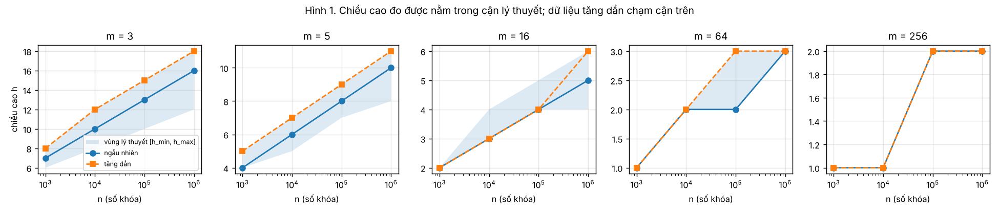
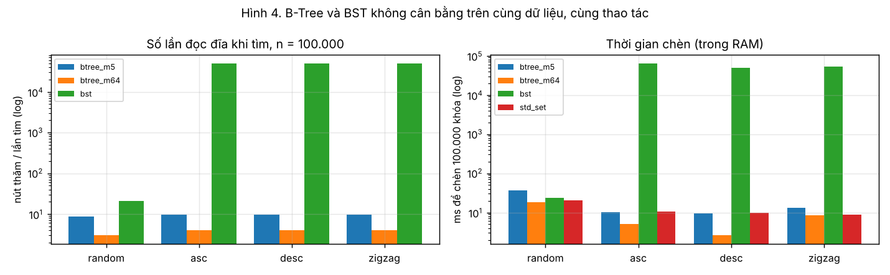
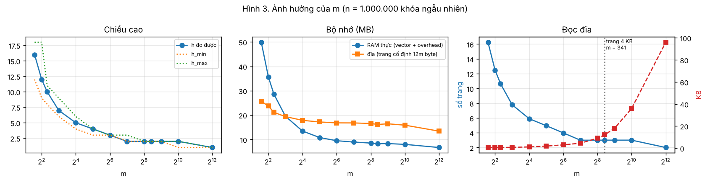

# Báo cáo tổng – B-Tree for Disk-Oriented Search

| Mục | Nội dung |
|---|---|
| Trường / Khoa | HCMC University of Technology and Education / Faculty of Informational Education |
| Môn học | Cấu trúc dữ liệu và Giải thuật · Đề tài Appendix A · Lesson 8 & 9 |
| Sinh viên | Đinh Mai Tuyết Nhi – MSSV 25110049 |
| Giảng viên hướng dẫn | Huỳnh Xuân Phụng |
| Kho mã nguồn | https://github.com/dinhmaituyetnhi220207-cmyk/dsa_B-TREE |
| Ngôn ngữ | C++17, không dùng thư viện ngoài |
| Báo cáo từng tuần | [Tuần 1](../week1/report.md) · [Kế hoạch kiểm thử](../week1/test-plan.md) · [Tuần 2](../week2/report.md) · [Tuần 3](../week3/report.md) |

## 1. Tóm tắt

Đề tài cài đặt B-Tree bậc m (m ≥ 3) theo định nghĩa của Knuth, với đủ các thao tác tìm, chèn (tách khi tràn), xóa (mượn / gộp), duyệt theo thứ tự và kiểm tra hợp lệ, cùng bộ đếm số nút được thăm để mô phỏng số lần đọc đĩa. Kết quả chính:

- **Đúng:** 45/45 kiểm tra đơn vị (T1–T16, khớp bản chạy tay Tuần 1), 630.000 thao tác ngẫu nhiên đối chiếu `std::set`, 14/14 trường hợp biên và đối kháng (E1–E14), không lỗi dưới AddressSanitizer / UBSan.
- **Khớp lý thuyết:** 80/80 cấu hình (n = 103 … 106, m = 3 … 256, 4 kiểu dữ liệu, 5 seed) có chiều cao trong [hmin, hmax]; số lần tách khớp công thức 1 / (f(m − 1)) tới 3 chữ số.
- **Đọc đĩa:** với 106 khóa, m = 256 chỉ cần 3 lần đọc mỗi lần tìm; m = 3 cần 16–19 lần; BST không cân bằng cần 25,5 lần với dữ liệu ngẫu nhiên và ~500.000 lần với dữ liệu có thứ tự.
- **Chọn m:** m lớn nhất mà một nút vừa một khối đĩa; với khối 4 KB là m ≈ 341.
- **Điều không khớp lý thuyết:** thời gian CPU tăng nhanh hơn log n do cache; giải thích ở Mục 8.

## 2. Bài toán và thiết kế

### 2.1. Bài toán

Dữ liệu quá lớn để nằm trong RAM được lưu trên đĩa theo khối; chi phí một thao tác chủ yếu là **số khối phải đọc**. B-Tree cho mỗi nút chứa nhiều khóa (vừa một khối) để cây thấp và rộng. Yêu cầu: cài đặt B-Tree bậc m lưu khóa nguyên với search, insert, delete, duyệt theo thứ tự, validate; đo thời gian, chiều cao và số nút được thăm với các kiểu dữ liệu khác nhau; so sánh với BST; giải thích ảnh hưởng của m. Đặc tả đầy đủ đầu vào / đầu ra, phạm vi và tiêu chí hoàn thành: [Tuần 1, Mục 2](../week1/report.md#2-phát-biểu-bài-toán-theo-cách-hiểu-của-nhóm).

### 2.2. Định nghĩa và quy ước cài đặt

B-Tree bậc m (Knuth): mỗi nút tối đa m con và m − 1 khóa; nút không phải gốc có ít nhất ⌈m/2⌉ − 1 khóa; gốc không phải lá có ít nhất 2 con; nút có k khóa có đúng k + 1 con; khóa trong nút tăng dần và phân tách các cây con; mọi lá cùng độ sâu.

| Quy ước | Lựa chọn |
|---|---|
| Chèn | Luôn chèn vào lá; nút có **m khóa** (tràn) thì tách: giữ ⌊m/2⌋ khóa bên trái, đẩy khóa thứ ⌊m/2⌋ (đếm từ 0) lên cha, phần còn lại (m − ⌊m/2⌋ − 1 khóa) sang nút mới. Tách có thể lan tới gốc; gốc bị tách thì cây cao thêm 1. |
| Xóa | Khóa ở nút trong thì thay bằng **khóa liền trước** rồi xóa ở lá. Nút còn ít hơn ⌈m/2⌉ − 1 khóa thì: mượn anh em trái → mượn anh em phải → gộp (ưu tiên gộp với anh em trái). Gốc hết khóa thì cây thấp đi 1. |
| Khóa trùng | Không chèn, trả về `false`. |
| Tìm trong nút | Tìm nhị phân (`std::lower_bound`). |

Không dùng cách “tách sớm trên đường đi xuống” của CLRS: cách đó chỉ đúng khi số khóa tối đa là số lẻ (m chẵn), và với m lẻ sinh ra nút 1 khóa hoặc nút rỗng (lỗi AI phát hiện ở [Tuần 2, Mục 5](../week2/report.md#5-chỗ-ai-làm-sai--thiếu-và-cách-phát-hiện)). Lý do chọn B-Tree thay vì BST, AVL / đỏ-đen, bảng băm, B+ Tree: [Tuần 1, Mục 3.5](../week1/report.md#35-lý-do-chọn-b-tree).

## 3. Cài đặt

| Thành phần | Vị trí | Ghi chú |
|---|---|---|
| Cấu trúc `Node`, lớp `BTree` | [src/btree.h](../../src/btree.h) | `Node` gồm `vector<int> keys`, `vector<Node*> children`; là lá khi `children` rỗng |
| `search` | [btree.cpp#L30](../../src/btree.cpp#L30) | Vòng lặp; tùy chọn trả về đường đi |
| `insert` → `insertRec`, `splitNode` | [#L83](../../src/btree.cpp#L83), [#L62](../../src/btree.cpp#L62), [#L46](../../src/btree.cpp#L46) | Đệ quy xuống lá, tách khi quay lên |
| `remove` → `removeRec`, `fixChild`, `mergeChildren` | [#L172](../../src/btree.cpp#L172), [#L148](../../src/btree.cpp#L148), [#L117](../../src/btree.cpp#L117), [#L103](../../src/btree.cpp#L103) | Sửa thiếu khóa khi quay lên |
| `traverse`, `height`, `levels` | [#L194](../../src/btree.cpp#L194), [#L200](../../src/btree.cpp#L200), [#L207](../../src/btree.cpp#L207) | `levels()` in cây theo tầng, dùng cho test và `trace` |
| `validate` | [#L273](../../src/btree.cpp#L273), [`validateRec` #L246](../../src/btree.cpp#L246) | Kiểm tra đủ 5 tính chất, báo tên tính chất vi phạm |
| Bộ đếm và thống kê | `nodesVisited`, `splits`, `merges`, `borrows`, [`stats` #L236](../../src/btree.cpp#L236) | Đếm đọc đĩa, ghi đĩa (tách / gộp), bộ nhớ, độ lấp đầy |
| BST không cân bằng | [src/bst.h](../../src/bst.h), [src/bst.cpp](../../src/bst.cpp) | Viết bằng vòng lặp để không tràn stack khi suy biến |
| Công cụ in từng bước | [tools/trace.cpp](../../tools/trace.cpp) | `trace 4 +10 +20 +30 +40 -20` in cây sau mỗi thao tác |

## 4. Phân tích độ phức tạp

Ký hiệu: n số khóa, m bậc, t = ⌈m/2⌉, h chiều cao (số cạnh từ gốc tới lá). Mô hình chi phí có hai phần: **I/O** (số nút đọc / ghi, mỗi nút một trang) và **CPU** (số phép so sánh và dịch phần tử trong RAM).

### 4.1. Chiều cao

Cây thưa nhất: gốc có ≥ 1 khóa, tầng i ≥ 1 có ≥ 2ti−1 nút, mỗi nút ≥ t − 1 khóa, nên n ≥ 1 + (t − 1)·2·(th − 1)/(t − 1) = 2th − 1. Cây đầy nhất: n ≤ mh+1 − 1. Vậy

> ⌈logm(n + 1)⌉ − 1 ≤ h ≤ ⌊logt((n + 1)/2)⌋, tức **h = Θ(log n / log m)**.

### 4.2. Từng thao tác

| Thao tác | Đọc nút (I/O) | Ghi nút (I/O) | CPU | Lập luận |
|---|---|---|---|---|
| `search` | ≤ h + 1 | 0 | O(log m · h) = **O(log n)** | Mỗi tầng một nút; `lower_bound` O(log m); log m / log t ≤ hằng số vì t ≥ m/2 |
| `insert` | h + 1 | 1 + 2·(số lần tách) + [1 nếu tạo gốc mới] ≤ 2h + 4 | **O(m · logt n)** | Chèn vào lá dịch O(m); mỗi tầng tách nhiều nhất một nút, mỗi lần O(m) |
| `remove` | ≤ h + 1 trên đường đi + ≤ 2 anh em mỗi tầng | O(h) | **O(m · logt n)** | Tìm khóa liền trước đi tiếp cùng nhánh; mỗi tầng `fixChild` một lần: mượn hoặc gộp O(m) |
| `traverse`, `validate` | mọi nút | 0 | **O(n)** | Mỗi nút thăm đúng một lần, mỗi khóa O(1) lần |
| Bộ nhớ | – | – | **O(n)** | Số nút ≤ 1 + (n − 1)/(t − 1), mỗi nút O(m), m/(t − 1) ≤ 4 với m ≥ 3 |

Với m cố định, mọi thao tác trên một khóa đều O(log n) và không bao giờ suy biến, bất kể thứ tự dữ liệu. Đây là khác biệt cốt lõi so với BST: O(h) với h có thể bằng n − 1.

### 4.3. Phân tích khấu hao số lần tách

**Chỉ chèn:** mỗi lần tách tạo đúng một nút mới và không có nút nào bị hủy, nên tổng số lần tách = (số nút) − 1 ≤ (n − 1)/(t − 1). Do đó số lần tách **khấu hao trên mỗi lần chèn ≤ 1/(t − 1)**, tức O(1) và nhỏ dần khi m tăng, dù một lần chèn đơn lẻ có thể tách tới h + 1 nút. Đo được: số tách / số chèn = 1 / (f · (m − 1)), ví dụ 0,3692 với m = 5, n = 106 ngẫu nhiên.

**Chèn xen kẽ xóa:** chặn khấu hao O(1) **không còn đúng** với quy ước của đề tài. Trường hợp E9 / E10 (Mục 5.3) cho thấy một dãy {chèn x; xóa x} lặp lại có thể gây Θ(h) lần tách rồi Θ(h) lần gộp *ở mỗi thao tác*, vì nút ở đúng ngưỡng bị tách rồi gộp lại liên tục (Mục 8.5).

### 4.4. Đối chiếu với số đo

| Dự đoán | Số đo | Nguồn |
|---|---|---|
| hmin ≤ h ≤ hmax | 80/80 cấu hình × 5 seed | [results/height_reads.csv](../../results/height_reads.csv) |
| Tìm không thấy đọc đúng h + 1 nút; tìm thấy ≤ h + 1 | Đúng ở mọi dòng; trường hợp xấu nhất đo được = h + 1 | như trên |
| Chèn có thứ tự cho h = hmax (f = 50 %) | m = 3, 5, 16 chạm đúng hmax; f = 0,500 với m lẻ | như trên |
| Chèn ngẫu nhiên: f → ln 2 ≈ 0,69 (Yao, 1978) | f = 0,670 … 0,722 | [results/m_sweep.csv](../../results/m_sweep.csv) |
| BST ngẫu nhiên: tìm thấy thăm ≈ 2Hn − 3 nút | 21,06 (dự đoán 21,2) với n = 105; 25,54 (25,8) với n = 106 | [results/btree_vs_bst.csv](../../results/btree_vs_bst.csv) |
| BST có thứ tự: h = n − 1 | h = 99.999 với n = 105 | như trên |
| Bộ nhớ O(n) với mọi m | Mô hình trang cố định: 13–26 MB cho 106 khóa ở mọi m | [results/m_sweep.csv](../../results/m_sweep.csv) |
| Thời gian search O(log n) | **Không khớp**: số nút thăm × 2,3 nhưng thời gian × 12 khi n × 1000 (cache, Mục 8.3) | [results/height_reads.csv](../../results/height_reads.csv) |

## 5. Kiểm thử

### 5.1. Kiểm thử đơn vị và áp lực

| Bộ | Nội dung | Kết quả |
|---|---|---|
| [tests/test_btree.cpp](../../tests/test_btree.cpp) | T0–T16 theo [kế hoạch Tuần 1](../week1/test-plan.md): dựng cây Hình 1; tách gốc; chèn khớp bản chạy tay (T4); khóa trùng; tìm ở gốc / lá / không có; duyệt; xóa ở lá, mượn, xóa ở nút trong, gộp dây chuyền; 1…1000 tăng dần; trộn ngẫu nhiên đối chiếu `std::set` | **45/45** |
| [tests/stress_btree.cpp](../../tests/stress_btree.cpp) | 630.000 thao tác ngẫu nhiên, m = 3…9, `validate()` sau mỗi thao tác, đối chiếu `std::set` | Đạt |

### 5.2. Kiểm chứng trong thực nghiệm

Mọi cây trong thực nghiệm A (80 cấu hình × 5 lần) `validate()` đúng sau khi xóa một nửa số khóa; trong thực nghiệm B, `traverse()` của B-Tree và BST khớp `std::set` sau toàn bộ dãy thao tác.

### 5.3. Trường hợp biên và đối kháng ([tests/edge_cases.cpp](../../tests/edge_cases.cpp))

| Mã | Trường hợp | Kết quả |
|---|---|:---:|
| E1 | Cây rỗng: search, remove, height = −1, traverse rỗng, validate | PASS |
| E2 | Chèn 1 khóa rồi xóa → cây rỗng lại | PASS |
| E3 | Chèn cùng một khóa 100.000 lần → `true` đúng 1 lần | PASS |
| E4 | INT_MIN, INT_MAX, 0, −1, 1 (m = 3) | PASS |
| E5 | m = 2, 1, 0, −5 → ném `invalid_argument` | PASS |
| E6 | m = 3, 4, 6; 5.000 khóa tăng rồi giảm, validate sau mỗi lần chèn | PASS |
| E7 | Xóa hết 20.000 khóa theo 3 thứ tự rồi chèn lại | PASS |
| E8 | Xóa khóa không có (dưới min, trên max, ở giữa) → cây không đổi | PASS |
| E9 | **Đối kháng:** 100.000 lần {chèn 5; xóa 5} trên [1 2 3 4], m = 5 → 100.000 tách + 100.000 gộp | PASS |
| E10 | **Đối kháng:** m = 3, 2.047 khóa; khóa 773 gây 6 tách mỗi lần chèn, 6 gộp mỗi lần xóa | PASS |
| E11 | Tìm tuần tự và nhị phân cho cùng cây, cùng số nút thăm | PASS |
| E12 | m = 100.001: cả cây một nút, h = 0 | PASS |
| E13 | BST đối chiếu `std::set` qua 200.000 thao tác | PASS |
| E14 | BST 20.000 khóa tăng dần, h = 19.999, không tràn stack | PASS |

## 6. Thực nghiệm

Bộ thực nghiệm [bench/bench.cpp](../../bench/bench.cpp), mô tả đầy đủ ở [Tuần 3, Mục 3](../week3/report.md#3-bộ-thực-nghiệm). Khóa là số chẵn (số lẻ dùng cho tìm không thấy); 4 kiểu dữ liệu: ngẫu nhiên, tăng, giảm, zigzag; số lần đọc là số đếm chính xác, thời gian là trung vị nhiều lần chạy trên máy ảo 1 nhân (dao động ±20 %).

### 6.1. Chèn ≥ 100.000 khóa: chiều cao và số lần đọc đĩa (yêu cầu GVHD 1)

n = 1.000.000 (bảng đủ cho n = 105 và các kiểu dữ liệu khác: [Tuần 3, Mục 4](../week3/report.md#4-yêu-cầu-gvhd-1-chèn--100000-khóa--chiều-cao-và-số-lần-đọc-đĩa)):

| m | Kiểu | h | [hmin, hmax] | Số nút | Đọc / tìm thấy | Đọc / tìm không thấy | Đọc / xóa |
|:---:|---|:---:|:---:|---:|---:|---:|---:|
| 3 | ngẫu nhiên | 15–16 | [12, 18] | 745.853 | 16,25 | 17 | 16,05 |
| 3 | tăng dần | 18 | [12, 18] | 999.993 | 18,01 | 19 | 18,05 |
| 5 | ngẫu nhiên | 10 | [8, 11] | 369.197 | 10,63 | 11 | 11,00 |
| 5 | tăng dần | 11 | [8, 11] | 499.993 | 11,50 | 12 | 12,00 |
| 16 | ngẫu nhiên | 5 | [4, 6] | 97.246 | 5,90 | 6 | 6,00 |
| 64 | ngẫu nhiên | 3 | [3, 3] | 22.950 | 3,98 | 4 | 4,00 |
| 256 | ngẫu nhiên | 2 | [2, 2] | 5.642 | 3,00 | 3 | 3,00 |

### 6.2. So sánh với BST trên cùng dữ liệu, cùng thao tác (yêu cầu GVHD 2)

| n | Kiểu | Cấu trúc | h | Đọc / tìm thấy | Chèn n khóa (ms) |
|---:|---|---|---:|---:|---:|
| 105 | tăng dần | B-Tree m = 5 | 9 | 9,50 | 10,1 |
| | | B-Tree m = 64 | 3 | 3,97 | 5,1 |
| | | BST | **99.999** | **49.442** | **63.065** |
| 106 | ngẫu nhiên | B-Tree m = 5 | 10 | 10,62 | 888 |
| | | B-Tree m = 64 | 3 | 3,98 | 307 |
| | | BST | 48 | 25,54 | 910 |

Dữ liệu có thứ tự làm BST suy biến thành danh sách: chèn chậm hơn B-Tree 4.000–6.000 lần. Dữ liệu ngẫu nhiên: BST đọc nhiều nút gấp 2,4 lần (so với m = 5) đến 6,4 lần (so với m = 64). Bảng đủ: [Tuần 3, Mục 6](../week3/report.md#6-yêu-cầu-gvhd-2-b-tree-so-với-bst-trên-cùng-dữ-liệu-cùng-thao-tác).

### 6.3. Ảnh hưởng của m lên chiều cao, bộ nhớ và số lần đọc đĩa (yêu cầu GVHD 3)

| m | h | RAM (MB) | Đĩa (MB) | Trang (byte) | Trang đọc / lần tìm | KB đọc / lần tìm |
|---:|---:|---:|---:|---:|---:|---:|
| 3 | 16 | 49,9 | 25,6 | 36 | 16,26 | 0,6 |
| 16 | 5 | 13,5 | 17,8 | 192 | 5,90 | 1,1 |
| 64 | 3 | 9,5 | 16,8 | 768 | 3,98 | 3,0 |
| **341** | 2 | 8,3 | 16,2 | **4.092** | **3,00** | 12,0 |
| 4096 | 1 | 6,7 | 13,4 | 49.152 | 2,00 | 96,0 |

- **Chiều cao** giảm theo logm n: bình phương m thì h giảm khoảng một nửa.
- **Bộ nhớ** là O(n) với mọi m. m nhỏ tốn hơn vì tỉ lệ con trỏ trên khóa cao và chi phí cố định mỗi nút; trong RAM, m = 3 tốn gấp 6 lần m = 341.
- **Đọc đĩa:** số trang đọc giảm theo m, nhưng số byte đọc tăng. Đĩa đọc theo khối nên chi phí là số lần truy cập; chọn m lớn nhất để một nút vừa một khối: 12m ≤ 4096 ⇒ m = 341.

## 7. Thử cải tiến: duyệt tuần tự thay cho tìm nhị phân trong nút

Số nút thăm không đổi (E11), chỉ thời gian CPU thay đổi. Duyệt tuần tự nhanh hơn 5–15 % với 16 ≤ m ≤ 256, ngang nhau với m ≤ 8, chậm hơn 1,24 lần (m = 512) và 2,01 lần (m = 1024). **Loại bỏ**: lợi ích vài chục nanô giây không đáng kể so với một lần đọc đĩa (0,1–10 ms), và vùng m hợp lý cho đĩa (≈ 341) nằm gần điểm giao nhau. Số liệu: [Tuần 3, Mục 10](../week3/report.md#10-thử-cải-tiến-duyệt-tuần-tự-thay-cho-tìm-nhị-phân-trong-nút).

## 8. Những điều bất ngờ và giải thích

**8.1. Dữ liệu tăng dần làm cây cao hơn nhưng chèn lại nhanh hơn (tới 6–8 lần khi n = 106).** Ví dụ n = 106, m = 5: asc chèn 135 ns/khóa, random 807 ns/khóa, dù cây asc cao hơn (11 so với 10). Chênh lệch tăng theo n (1,3–4,5 lần ở n = 103, 6–8 lần ở n = 106), đúng như dự đoán nếu nguyên nhân là cache. Lý do: khóa tăng dần luôn đi theo cùng một đường bên phải, nên các nút trên đường đó luôn nằm sẵn trong cache CPU; khóa ngẫu nhiên mỗi lần đi một đường khác, gần như mọi nút đều trượt cache. Nếu là đĩa thật, điều tương tự xảy ra với bộ đệm trang của hệ điều hành. Vì vậy cơ sở dữ liệu thường chèn khóa tăng dần (ví dụ khóa tự tăng).

**8.2. m chẵn: dữ liệu tăng và giảm cho cây khác nhau.** Với m = 16, n = 105: asc cho h = 4, f = 0,533; desc cho h = 5, f = 0,467. Với m lẻ hai kiểu cho kết quả giống hệt. Lý do nằm ở quy tắc tách (Mục 2.2): nút tràn có m = 16 khóa, giữ **m/2 = 8** khóa bên trái, đẩy khóa thứ 9 lên, còn **7** khóa bên phải. Khi chèn tăng dần, nút bên trái (8 khóa) bị bỏ lại, nên f = 8/15 = 0,533. Khi chèn giảm dần, khóa mới luôn vào bên trái, nên nút bên phải (7 khóa, đúng mức tối thiểu) bị bỏ lại, f = 7/15 = 0,467 và cây cao thêm một tầng. Với m lẻ, hai nửa bằng nhau ((m − 1)/2 khóa) nên không lệch. Điều này không có trong lý thuyết chung về B-Tree vì phụ thuộc quy ước tách của cài đặt.

**8.3. Thời gian tìm tăng nhanh hơn log n.** Số nút thăm tăng 2,3 lần khi n tăng 1000 lần (đúng log), nhưng thời gian tăng 12 lần. Mô hình RAM của phân tích độ phức tạp coi mọi truy cập bộ nhớ có giá như nhau. Thực tế: với 103 khóa, cả cây (~30 KB) nằm trong cache L1/L2; với 106 khóa (~29 MB) cây lớn hơn cache, nên mỗi nút ở tầng dưới là một lần trượt cache (~100 ns). Bộ nhớ chính đóng vai trò “đĩa” đối với cache. Đây chính là lý do B-Tree cũng được dùng làm cấu trúc trong RAM: **m lớn giảm số lần trượt cache** giống như giảm số lần đọc đĩa (Mục 6.3).

**8.4. Trong RAM, BST ngẫu nhiên nhanh ngang (hoặc hơn) B-Tree m = 5 dù thăm nhiều nút gấp 2,4 lần.** Lý do: một nút BST rất nhỏ và so sánh ở mỗi nút chỉ một phép, trong khi mỗi nút B-Tree m = 5 cần `lower_bound` trên một `vector` riêng (thêm một lần nhảy con trỏ tới vùng nhớ của vector) và chèn phải dịch phần tử. Lợi thế của B-Tree chỉ hiện ra khi **chi phí mỗi lần thăm nút lớn** (đọc đĩa), hoặc khi m đủ lớn (m = 64 tìm nhanh hơn BST 1,8 lần ở n = 105 và 4,7 lần ở n = 106). Đây đúng là lý do đề tài gọi là “disk-oriented”.

**8.5. Không có “vùng đệm” giữa tách và gộp.** Trường hợp E10 (Mục 5.3): ở một cây 2.047 khóa với m = 3, chèn rồi xóa cùng một khóa lặp lại 10.000 lần gây **6 lần tách cho mỗi lần chèn và 6 lần gộp cho mỗi lần xóa**, thay vì 0 hay 1. E9 cho kết quả tương tự ở cây nhỏ: 100.000 tách và 100.000 gộp. Nguyên nhân: quy ước của chúng em gộp ngay khi nút xuống dưới mức tối thiểu và tách ngay khi tràn, nên một nút ở đúng ngưỡng bị tách rồi gộp lại liên tục. Với dữ liệu ngẫu nhiên điều này hiếm (số gộp/lần xóa trung bình ~0,7 ở m = 3 và ~0,005 ở m = 256), nhưng một dãy thao tác đối kháng có thể làm mỗi thao tác tốn h lần ghi đĩa. Cách khắc phục (chưa cài đặt, để ngoài phạm vi): chỉ gộp khi nút trống hẳn hoặc dưới một ngưỡng thấp hơn (“lazy deletion”), hoặc chia khóa sang anh em trước khi tách (B\*-Tree).

## 9. Hạn chế

1. **Không có đĩa thật.** Cây nằm trong RAM; “đọc đĩa” là số nút được thăm. Mô hình bỏ qua bộ đệm trang (thực tế gốc và tầng 1 thường nằm sẵn trong RAM), nên số đo là cận trên của số lần đọc thật, và không đo được độ trễ thật của HDD / SSD. Các con số mili giây cho đĩa trong báo cáo là ước tính từ giả định.
2. **Bộ đếm khi xóa đếm thiếu.** `nodesVisited()` chỉ đếm các nút trên đường đi xuống; các nút anh em mà `fixChild` đọc để mượn / gộp và đường đi tìm khóa liền trước (đi hai lần trên cùng nhánh) không được đếm. Số “đọc / xóa” ở Mục 6 vì vậy thấp hơn thực tế. Số lần ghi đĩa chỉ được suy ra từ số tách / gộp / mượn, không đếm trực tiếp.
3. **Khóa chỉ là `int`, không có giá trị kèm theo, không trùng khóa.** Một chỉ mục thật lưu cặp (khóa, con trỏ bản ghi) và thường cho phép trùng khóa.
4. **Không có truy vấn khoảng, nạp hàng loạt (bulk loading), hay đa luồng.**
5. **Không có khấu hao O(1) khi chèn xen kẽ xóa** (Mục 4.3, 8.5): một dãy đối kháng làm mỗi thao tác tốn Θ(h) lần tách / gộp.
6. **Nút dùng `std::vector`**, nên bộ nhớ RAM có phần thừa (dung lượng vector) và mỗi nút là hai vùng nhớ riêng; đây không phải bố cục một trang liền mạch như trên đĩa. Số bộ nhớ không tính chi phí của bộ cấp phát.
7. **So sánh với BST chỉ dùng BST không cân bằng** như đề yêu cầu; cây cân bằng (`std::set`, đỏ-đen) chỉ được đo thời gian, không đếm được số nút thăm.
8. **Thời gian đo trên máy ảo 1 nhân**, dao động ±20 %; chỉ nên so sánh thời gian trong cùng một bảng. Số lần đọc thì chính xác và chạy lại cho ra đúng như cũ.

## 10. Ánh xạ yêu cầu → vị trí trong code và báo cáo

| # | Yêu cầu | Code | Kiểm chứng | Báo cáo |
|:---:|---|---|---|---|
| 1 | Tìm kiếm, trả về có/không và đường đi | [`BTree::search` btree.cpp#L30](../../src/btree.cpp#L30) | T6–T8 | Mục 4.2 |
| 2 | Chèn, giữ đủ tính chất (tách khi tràn) | [`insert` #L83](../../src/btree.cpp#L83), [`insertRec` #L62](../../src/btree.cpp#L62), [`splitNode` #L46](../../src/btree.cpp#L46) | T1–T5, T15, E3, E6 | Mục 2.2, 4.2 |
| 3 | Xóa, giữ đủ tính chất (mượn / gộp) | [`remove` #L172](../../src/btree.cpp#L172), [`removeRec` #L148](../../src/btree.cpp#L148), [`fixChild` #L117](../../src/btree.cpp#L117), [`mergeChildren` #L103](../../src/btree.cpp#L103) | T10–T14, E7, E8 | Mục 2.2, 4.2 |
| 4 | Duyệt theo thứ tự | [`traverse` #L194](../../src/btree.cpp#L194) | T9, stress | Mục 4.2 |
| 5 | Kiểm tra hợp lệ đủ 5 tính chất | [`validate` #L273](../../src/btree.cpp#L273), [`validateRec` #L246](../../src/btree.cpp#L246) | Gọi sau mọi thao tác trong stress, E6 | Mục 2.2 |
| 6 | Mô phỏng số lần đọc đĩa | `nodesVisited` (btree.cpp#L33, #L63, #L149) | T6–T8, E12 | Mục 4.2, 9 |
| 7 | Chèn ≥ 100.000 khóa, báo h và số lần đọc với ≥ 3 giá trị m | [`expHeight`](../../bench/bench.cpp), [results/height_reads.csv](../../results/height_reads.csv) | 80/80 trong cận | Mục 6.1 |
| 8 | So sánh BST cùng dữ liệu, cùng thao tác | [src/bst.cpp](../../src/bst.cpp), `expBst` trong [bench.cpp](../../bench/bench.cpp) | E13, E14 | Mục 6.2 |
| 9 | Ảnh hưởng của m lên h, bộ nhớ, đọc đĩa | [`stats` #L236](../../src/btree.cpp#L236), `expMSweep` | – | Mục 6.3 |
| 10 | Thực nghiệm so với lý thuyết | [bench/plot.py](../../bench/plot.py) | – | Mục 4.4 |
| 11 | Dữ liệu đa dạng và đối kháng | `makeKeys` (4 kiểu), [tests/edge_cases.cpp](../../tests/edge_cases.cpp) | E1–E14 | Mục 5.3, 6 |
| 12 | Thử một cải tiến, giữ hoặc loại có số liệu | `setNodeSearch`, [`lowerIndex` #L20](../../src/btree.cpp#L20), `expOpt` | E11 | Mục 7 |
| 13 | Ví dụ chạy tay và demo | [src/main.cpp](../../src/main.cpp), [tools/trace.cpp](../../tools/trace.cpp) | T4 | [Tuần 1, Mục 4](../week1/report.md#4-ví-dụ-chạy-tay), Mục 12.2 |
| 14 | Chạy lại được toàn bộ | [run_all.sh](../../run_all.sh), [run_all.bat](../../run_all.bat), [README](../../README.md) | – | Mục 13 |
| 15 | Nhật ký sử dụng AI | [docs/ai-log.md](../ai-log.md) | – | Mục 11 |

## 11. Sử dụng AI

| Tuần | Công cụ | Phần AI làm | Lỗi AI đã phát hiện |
|---|---|---|---|
| 1 | Gemini 3.6 | Giải thích định nghĩa và ứng dụng B-Tree | Có đoạn chép nguyên văn, sinh viên viết lại ([ai-log, Tuần 1](../ai-log.md#tuần-1)) |
| 2 | Gemini Flash 3.6 | Bản cài đặt ban đầu | Tách sớm kiểu CLRS sai với m lẻ; `validate` thiếu 3 tính chất; `visited_` không tăng; không biên dịch được; `remove` chưa có ([Tuần 2, Mục 5](../week2/report.md#5-chỗ-ai-làm-sai--thiếu-và-cách-phát-hiện)) |
| 3 | Claude Opus 5.5 | Bộ đếm, `stats`, BST, bộ thực nghiệm, trường hợp biên, bản nháp báo cáo | E10 bản đầu không gây tách; cột h lệch số lần đọc; đo h BST sau khi xóa ([Tuần 3, Mục 11](../week3/report.md#11-chỗ-ai-làm-sai--thiếu-trong-tuần-3-và-cách-phát-hiện)) |
| 4 | Claude Opus 5.5 | Bản nháp báo cáo tổng (Mục 1–11, 13–14), `run_all`, `tools/trace.cpp` | Chạy `run_all --quick` lần đầu ghi đè `results/` chính thức và vẽ hình lỗi vì thiếu n = 106; sửa bằng cách cho chế độ nhanh ghi vào `results/quick/` |

Mục 12 dành cho sinh viên tự viết; AI chỉ soạn các dòng gợi ý in nghiêng.

## 12. Phần sinh viên tự viết

> Phần này dùng để chứng minh em hiểu đề tài, nên em tự viết và tự chạy tay. Công cụ `trace` chỉ dùng để **kiểm tra lại sau khi** đã chạy tay xong.

### 12.1. Self-Explanation cho từng yêu cầu

*Với mỗi dòng của bảng Mục 10: giải thích bằng lời của em code làm gì, vì sao đúng, và một chỗ dễ sai.*

### 12.2. Chạy tay lại tách / gộp với m chẵn và trường hợp E9

*Gợi ý đề bài để tự làm (vẽ trên giấy, chụp ảnh đưa vào `docs/final/images/`):*

1. *m = 4: chèn 10, 20, 30, 40, 50, 60, 70 vào cây rỗng. Vẽ cây sau mỗi lần tách. Nút trái và nút phải giữ bao nhiêu khóa? So với m = 5.*
2. *m = 4: chèn 70, 60, 50, 40, 30, 20, 10 (giảm dần). So sánh chiều cao và số khóa mỗi nút với câu 1, rồi giải thích bằng quy tắc tách ở Mục 2.2 (liên hệ Mục 8.2).*
3. *m = 4: từ cây ở câu 1, xóa lần lượt 70, 60, 10. Mỗi lần xóa: mượn trái, mượn phải hay gộp? Vì sao?*
4. *E9: m = 5, cây [1 2 3 4]. Vẽ cây sau “chèn 5” và sau “xóa 5”. Vì sao lặp lại 100.000 lần thì có đúng 100.000 tách và 100.000 gộp? Đề xuất một cách sửa và chạy tay lại để thấy nó hết lặp.*

*Kiểm tra: `build/trace 4 +10 +20 +30 +40 +50 +60 +70 -70 -60 -10` và `build/trace 5 +1 +2 +3 +4 +5 -5 +5 -5`. Ghi lại chỗ nào bản chạy tay của em khác với `trace` và vì sao.*

### 12.3. Mười câu hỏi vấn đáp em dự đoán và câu trả lời

*Tự soạn 10 câu thầy có thể hỏi (gợi ý chủ đề: định nghĩa và quy ước; chứng minh cận chiều cao; vì sao không dùng tách sớm của CLRS; độ phức tạp từng thao tác; vì sao chọn m = 341; vì sao BST ngẫu nhiên nhanh ngang B-Tree trong RAM; m chẵn và độ lệch tăng / giảm; E9 và cách khắc phục; lỗi AI và cách em phát hiện; một hạn chế ở Mục 9). Trả lời ngắn, bằng lời của em.*

### 12.4. Điều khó nhất và em học được gì

*…*

### 12.5. Nếu có thêm 2 tuần, em sẽ thay đổi gì

*…*

## 13. Chạy lại toàn bộ

Xem [README](../../README.md#chạy-lại-toàn-bộ). Tóm tắt: `sh run_all.sh` (Linux / macOS / Git Bash) hoặc `run_all.bat` (Windows, cần g++ MinGW-w64). Thêm `--quick` để chạy nhanh khoảng 4 phút; kết quả nhanh ghi vào `results/quick/`, không đè lên số liệu chính thức.

## 14. Tài liệu tham khảo

1. T. H. Cormen, C. E. Leiserson, R. L. Rivest, C. Stein, *Introduction to Algorithms*, 3rd ed., MIT Press, 2009, Chapter 18: B-Trees.
2. D. E. Knuth, *The Art of Computer Programming, Vol. 3: Sorting and Searching*, 2nd ed., Addison-Wesley, 1998, §6.2.4.
3. R. Bayer, E. McCreight, “Organization and Maintenance of Large Ordered Indexes,” *Acta Informatica*, vol. 1, no. 3, pp. 173–189, 1972.
4. A. C.-C. Yao, “On Random 2–3 Trees,” *Acta Informatica*, vol. 9, pp. 159–170, 1978.
5. GeeksforGeeks, “Introduction of B-Tree,” https://www.geeksforgeeks.org/dsa/introduction-of-b-tree-2/ (truy cập ngày 5/10/2026).
