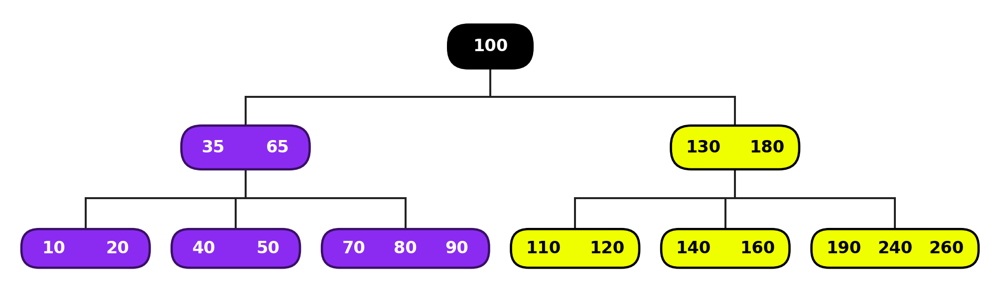
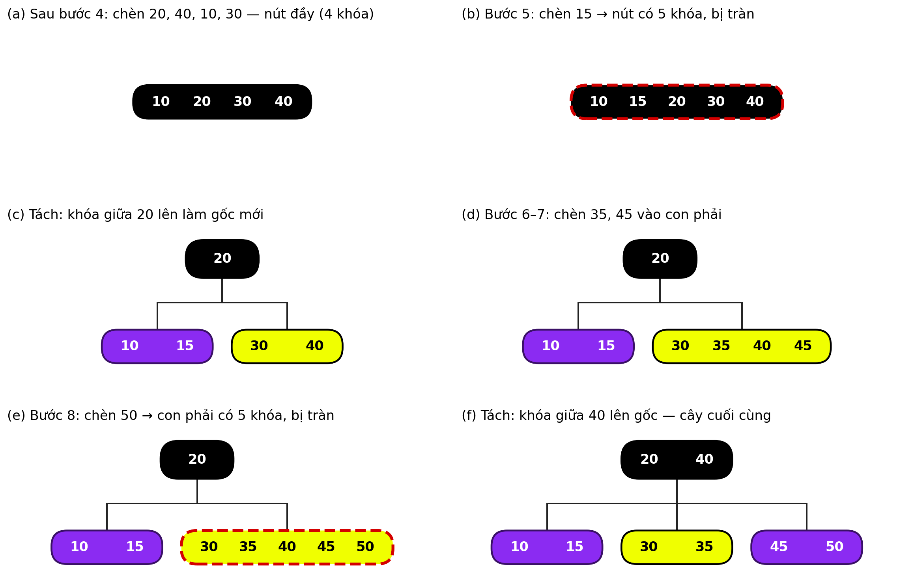
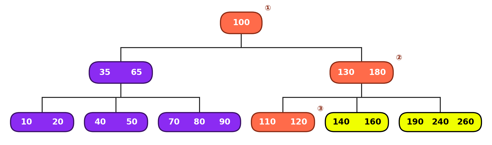

# Báo cáo Tuần 1 – Cài đặt và phân tích cây B (B-Tree)

**Tuần 1 – Hiểu đề và lập kế hoạch (Understand & Plan)**

## 1. Thông tin chung

| Mục | Nội dung |
|---|---|
| Trường / Khoa | **[ĐIỀN: tên trường]** / **[ĐIỀN: tên khoa]** |
| Môn học | Cấu trúc dữ liệu và Giải thuật (Data Structures & Algorithms) |
| Đề tài (Appendix A) | **[ĐIỀN: số đề tài]** |
| Chương lý thuyết liên quan | **[ĐIỀN: chương được phân công]** |
| Sinh viên | Đinh Mai Tuyết Nhi – MSSV 25110049 **[kiểm tra lại]** |
| Giảng viên hướng dẫn | **[ĐIỀN]** |
| Kho mã nguồn | **[ĐIỀN: link GitHub]** |
| Ngôn ngữ cài đặt | **[ĐIỀN: C++ / Python / Java]** |
| Thời gian | 4 tuần. Báo cáo này thuộc **Tuần 1 – Hiểu đề và lập kế hoạch** |

## 2. Phát biểu bài toán theo cách hiểu của nhóm

### 2.1. Bối cảnh

Khi dữ liệu quá lớn để nằm trọn trong bộ nhớ trong (ví dụ chỉ mục của cơ sở dữ liệu, thư mục của hệ thống tập tin), dữ liệu được lưu trên đĩa theo từng khối (block). Mỗi lần đọc một khối từ đĩa chậm hơn truy cập RAM rất nhiều lần, nên chi phí của một thao tác chủ yếu được quyết định bởi **số khối phải đọc**, tức số nút phải thăm trên cây.

Với cây tìm kiếm nhị phân cân bằng, mỗi nút chỉ chứa một khóa; tìm một khóa trong 1 triệu khóa phải đi qua khoảng 20 tầng, tương ứng khoảng 20 lần đọc đĩa. Ý tưởng của B-Tree là cho mỗi nút chứa nhiều khóa (vừa một khối đĩa) để cây trở nên **thấp và rộng**: với bậc m = 256, cây chứa 1 triệu khóa chỉ cao tối đa 3 tầng (Mục 3.3).

### 2.2. Yêu cầu bài toán

Cài đặt cấu trúc B-Tree bậc m (m ≥ 3) lưu các khóa số nguyên, hỗ trợ:

- **Tìm kiếm** (search): cho khóa k, trả về có hay không và đường đi từ gốc.
- **Chèn** (insert): thêm khóa k mà vẫn giữ đúng mọi tính chất của B-Tree.
- **Xóa** (delete): xóa khóa k mà vẫn giữ đúng mọi tính chất.
- **Duyệt theo thứ tự** (in-order traversal): liệt kê toàn bộ khóa tăng dần.
- **Kiểm tra hợp lệ** (validate): xác nhận cây thỏa mọi tính chất sau mỗi thao tác.
- **Thực nghiệm**: đo thời gian, chiều cao và số nút được thăm với các kiểu dữ liệu khác nhau.

### 2.3. Đầu vào và đầu ra

| Thao tác | Đầu vào | Đầu ra |
|---|---|---|
| Khởi tạo | Bậc m | Cây rỗng |
| `search(k)` | Khóa k | true/false và danh sách các nút đã thăm |
| `insert(k)` | Khóa k | true nếu chèn được; false nếu k đã tồn tại |
| `remove(k)` | Khóa k | true nếu xóa được; false nếu k không tồn tại |
| `traverse()` | – | Danh sách khóa tăng dần |
| `validate()` | – | true, hoặc tên tính chất bị vi phạm |

### 2.4. Phạm vi và giả định

- Khóa là số nguyên và không trùng nhau; chèn một khóa đã có thì bỏ qua và trả về false.
- Cây được lưu trong RAM. Để mô phỏng chi phí đọc đĩa, chương trình đếm số nút được thăm trong mỗi thao tác.
- Không cài đặt lưu trữ trên đĩa thật và không xử lý truy cập đồng thời (đa luồng).
- Bậc dùng cho ví dụ và kiểm thử chức năng là m = 5; khi đo hiệu năng sẽ thử thêm nhiều giá trị m.

### 2.5. Tiêu chí hoàn thành

1. Mọi thao tác giữ đúng các tính chất của B-Tree (`validate()` luôn trả về true).
2. Kết quả của chương trình khớp với ví dụ chạy tay ở Mục 4 và các kết quả mong đợi ở Mục 5.
3. Số liệu thực nghiệm phù hợp với phân tích độ phức tạp ở Mục 3.4.

## 3. Cơ sở lý thuyết và lựa chọn cấu trúc dữ liệu

### 3.1. Định nghĩa B-Tree bậc m

Theo định nghĩa của Knuth [2], B-Tree bậc m là cây tìm kiếm nhiều nhánh thỏa:

1. Mỗi nút có tối đa m con và tối đa m − 1 khóa.
2. Mỗi nút trong không phải gốc có ít nhất ⌈m/2⌉ con; mỗi nút không phải gốc có ít nhất ⌈m/2⌉ − 1 khóa.
3. Gốc, nếu không phải lá, có ít nhất 2 con; nếu gốc là lá (cây chỉ có một nút) thì có từ 1 đến m − 1 khóa.
4. Một nút trong có k khóa thì có đúng k + 1 con.
5. Các khóa trong một nút xếp tăng dần: k<sub>1</sub> < k<sub>2</sub> < … < k<sub>n</sub>; mọi khóa trong cây con thứ i nằm giữa k<sub>i−1</sub> và k<sub>i</sub>.
6. Mọi lá nằm cùng một độ sâu.

**Bảng 3. Giới hạn số khóa và số con khi m = 5**

| Loại nút | Số khóa | Số con |
|---|:---:|:---:|
| Gốc là lá (cây một nút) | 1 – 4 | 0 |
| Gốc không là lá | 1 – 4 | 2 – 5 |
| Nút trong khác gốc | 2 – 4 | 3 – 5 |
| Lá khác gốc | 2 – 4 | 0 |

**Lưu ý về quy ước.** Sách CLRS [1] định nghĩa B-Tree theo *bậc tối thiểu* t: mỗi nút không phải gốc có từ t − 1 đến 2t − 1 khóa. Định nghĩa này chỉ tương ứng với bậc m chẵn (m = 2t), nên không mô tả được cây bậc 5. Báo cáo này dùng thống nhất định nghĩa theo bậc m; ký hiệu t = ⌈m/2⌉ chỉ dùng với nghĩa *số con tối thiểu của một nút trong* (Mục 3.3).

Cấu trúc một nút dự kiến (xem khai báo thật trong [`src/btree.h`](../../src/btree.h)):

```cpp
struct Node {
    std::vector<int>   keys;      // tăng dần; tối đa m-1 khóa (tạm thời m khi tràn)
    std::vector<Node*> children;  // rỗng nếu là lá; ngược lại có keys.size()+1 con
};
```

### 3.2. Ví dụ một B-Tree bậc 5



*Hình 1. B-Tree bậc 5 gồm 19 khóa, cao h = 2 (3 tầng).*

Hình 1 thỏa đủ định nghĩa: gốc có 1 khóa và 2 con; nút [35, 65] và [130, 180] đều có 2 khóa và 3 con; mọi lá có 2–3 khóa và nằm cùng tầng; các khóa 140, 160 ở con giữa của [130, 180] nằm giữa 130 và 180.

### 3.3. Chiều cao của B-Tree

Gọi h là chiều cao (số cạnh từ gốc đến lá) của một B-Tree bậc m chứa n ≥ 1 khóa, và t = ⌈m/2⌉.

**Cận trên (cây thưa nhất).** Gốc có ít nhất 1 khóa và 2 con; mỗi nút trong khác có ít nhất t con; mỗi nút không phải gốc có ít nhất t − 1 khóa. Do đó tầng i (1 ≤ i ≤ h) có ít nhất 2t<sup>i−1</sup> nút, suy ra

> n ≥ 1 + (t − 1)·(2 + 2t + … + 2t<sup>h−1</sup>) = 2t<sup>h</sup> − 1  ⇒  **h ≤ log<sub>t</sub>((n + 1)/2)**

**Cận dưới (cây đầy nhất).** Mọi nút có m − 1 khóa và m con, nên n ≤ m<sup>h+1</sup> − 1, suy ra **h ≥ ⌈log<sub>m</sub>(n + 1)⌉ − 1**.

**Bảng 4. Chiều cao khi lưu n = 1.000.000 khóa**

| Cấu trúc | Chiều cao h (số cạnh) |
|---|:---:|
| Cây nhị phân cân bằng hoàn hảo | 19 (20 tầng) |
| Cây AVL, trường hợp xấu nhất (≈ 1,44·log<sub>2</sub> n) | ≈ 28 |
| B-Tree bậc 5 (t = 3) | 8 ≤ h ≤ 11 |
| B-Tree bậc 256 (t = 128) | h = 2 (3 tầng) |

### 3.4. Độ phức tạp dự kiến

Đánh giá sơ bộ; phần chứng minh chi tiết sẽ có trong báo cáo Tuần 2.

| Thao tác | Số nút được thăm | Thời gian CPU |
|---|---|---|
| Tìm kiếm | O(h) = O(log<sub>t</sub> n) | O(m·log<sub>t</sub> n) nếu duyệt tuần tự trong nút; O(log n) nếu tìm nhị phân trong nút |
| Chèn | O(log<sub>t</sub> n) | O(m·log<sub>t</sub> n): mỗi lần tách nút tốn O(m), tối đa h + 1 lần tách |
| Xóa | O(log<sub>t</sub> n) | O(m·log<sub>t</sub> n): mỗi lần mượn hoặc gộp tốn O(m) |
| Duyệt theo thứ tự | Mọi nút | O(n) |
| Bộ nhớ | – | O(n) |

### 3.5. Lý do chọn B-Tree

| Cấu trúc | Ưu điểm | Hạn chế so với yêu cầu |
|---|---|---|
| Cây BST thường | Đơn giản | Có thể suy biến thành danh sách, O(n), khi dữ liệu đã sắp xếp |
| AVL, cây đỏ-đen | Luôn cân bằng, O(log n) | Mỗi nút một khóa nên cây cao (≈ 20–28 tầng với 10<sup>6</sup> khóa), tốn nhiều lần đọc đĩa |
| Bảng băm | Tìm kiếm trung bình O(1) | Không giữ thứ tự, không hỗ trợ duyệt có thứ tự và truy vấn khoảng |
| B+ Tree | Truy vấn khoảng nhanh nhờ các lá nối nhau | Là biến thể mở rộng của B-Tree; cần nắm vững B-Tree trước |
| **B-Tree (chọn)** | Luôn cân bằng, cây thấp, giữ thứ tự khóa | Cài đặt phức tạp hơn (tách, mượn, gộp nút) |

B-Tree đáp ứng đúng mục tiêu của đề tài: giảm số nút phải thăm nhờ mỗi nút chứa nhiều khóa, luôn cân bằng với mọi thứ tự dữ liệu đầu vào, và vẫn giữ thứ tự khóa để duyệt và tìm kiếm.

### 3.6. Quy ước cài đặt được chọn

- **Bậc:** định nghĩa theo bậc m; ví dụ và kiểm thử dùng m = 5. Chọn m lẻ để khi một nút tràn (có 5 khóa) luôn có đúng một khóa giữa (khóa thứ 3).
- **Chèn:** luôn chèn vào lá. Nếu nút có m khóa (tràn) thì tách thành hai nút và đẩy khóa giữa lên nút cha; việc tách có thể lan lên gốc, khi gốc bị tách thì cây cao thêm 1.
- **Xóa:** nếu khóa nằm ở nút trong, thay bằng khóa liền trước rồi xóa khóa đó ở lá. Nếu một nút còn ít hơn ⌈m/2⌉ − 1 khóa: mượn từ anh em bên trái nếu có dư; nếu không thì mượn từ anh em bên phải; nếu cả hai không dư thì gộp với một anh em cùng khóa phân cách ở cha. Gộp có thể lan lên gốc; khi gốc hết khóa thì cây thấp đi 1.
- **Khóa trùng:** không chèn, trả về false.

Sách CLRS [1] tách nút sớm ngay trên đường đi xuống. Với cùng một dãy khóa, hai cách có thể cho ra hai cây khác nhau, vì vậy kết quả mong đợi ở Mục 4 và Mục 5 chỉ đúng với quy ước trên.

## 4. Ví dụ chạy tay

### 4.1. Chèn 8 khóa vào B-Tree bậc 5 rỗng

Chèn lần lượt **20, 40, 10, 30, 15, 35, 45, 50** vào B-Tree bậc 5 rỗng (mỗi nút tối đa 4 khóa).

**Bảng 7. Các bước chèn**

| Bước | Chèn | Diễn giải | Cây sau bước |
|:---:|:---:|---|---|
| 1 | 20 | Cây rỗng: tạo nút gốc, đồng thời là lá | [20] |
| 2 | 40 | 40 > 20: chèn vào cuối nút | [20, 40] |
| 3 | 10 | Chèn vào đầu nút, giữ thứ tự tăng | [10, 20, 40] |
| 4 | 30 | Chèn giữa 20 và 40; nút có 4 khóa (đầy) | [10, 20, 30, 40] |
| 5 | 15 | Nút thành [10, 15, 20, 30, 40] có 5 khóa > 4: tràn. Tách: khóa giữa 20 lên làm gốc mới; chiều cao tăng từ 0 lên 1 | Gốc [20]<br>Lá [10, 15], [30, 40] |
| 6 | 35 | 35 > 20: xuống con phải | Gốc [20]<br>Lá [10, 15], [30, 35, 40] |
| 7 | 45 | 45 > 20: xuống con phải; nút có 4 khóa (đầy) | Gốc [20]<br>Lá [10, 15], [30, 35, 40, 45] |
| 8 | 50 | Con phải thành [30, 35, 40, 45, 50]: tràn. Tách: khóa giữa 40 lên gốc | Gốc [20, 40]<br>Lá [10, 15], [30, 35], [45, 50] |



*Hình 2. Các trạng thái chính (viền đỏ nét đứt: nút bị tràn).*

**Kiểm tra cây cuối:** gốc có 2 khóa và 3 con; mỗi lá có 2 khóa (bằng số khóa tối thiểu); mọi lá cùng tầng; các khóa 30, 35 của con giữa nằm giữa 20 và 40.

**Nhận xét:** chỉ có hai lần tách (bước 5 và 8), xảy ra khi một nút vượt quá m − 1 = 4 khóa. Cây chỉ cao thêm khi gốc bị tách và khi đó mọi lá cùng xuống một tầng, nên các lá luôn cùng độ sâu: đây là lý do B-Tree luôn cân bằng với mọi thứ tự chèn.

> **[CHÈN ẢNH: ảnh chụp bản chạy tay trên giấy của sinh viên cho 8 bước ở Bảng 7]**

*Hình 3. Bản chạy tay trên giấy (sinh viên tự vẽ).*

### 4.2. Tìm kiếm trên cây vừa xây dựng

| Lệnh | Bước | Nút đang xét | So sánh | Quyết định |
|---|:---:|---|---|---|
| `search(35)` | 1 | [20, 40] | 20 < 35 < 40 | Xuống con thứ 2 |
| | 2 | [30, 35] | 35 = 35 | Tìm thấy (thăm 2 nút) |
| `search(25)` | 1 | [20, 40] | 20 < 25 < 40 | Xuống con thứ 2 |
| | 2 | [30, 35] | 25 < 30, nút là lá | Không tìm thấy (thăm 2 nút) |

### 4.3. Tìm khóa 120 trên cây ở Hình 1



*Hình 4. Đường đi khi tìm khóa 120 (nút tô đỏ, đánh số theo thứ tự thăm).*

| Bước | Nút đang xét | So sánh | Quyết định |
|:---:|---|---|---|
| ① | [100] | 120 > 100 | Xuống con phải |
| ② | [130, 180] | 120 < 130 | Xuống con thứ nhất |
| ③ | [110, 120] | 110 < 120; 120 = 120 | Tìm thấy |

Số nút được thăm là 3 = h + 1: số lần đọc đĩa của thao tác tìm kiếm bằng chiều cao cây cộng một.

## 5. Kế hoạch kiểm thử

Chi tiết 16 test case kèm kết quả mong đợi, hàm `validate()` và thiết kế thực nghiệm hiệu năng: xem **[test-plan.md](test-plan.md)**.

- Kết quả mong đợi được tính tay trước khi viết code, theo quy ước ở Mục 3.6.
- Sang Tuần 2, mỗi test case được cài thành một unit test.
- Sau mỗi thao tác chèn hoặc xóa, gọi `validate()` để kiểm tra toàn bộ tính chất của cây.

## 6. Kế hoạch thực hiện 4 tuần

| Tuần | Nội dung | Sản phẩm nộp |
|:---:|---|---|
| 1 | Hiểu đề; chọn cấu trúc dữ liệu và lý do; chạy tay; kế hoạch kiểm thử; khung mã C++ | Báo cáo Tuần 1; nhật ký AI |
| 2 | Cài đặt search, insert, remove, traverse, validate; unit test T1–T16; chứng minh độ phức tạp; ghi nhận ít nhất một chỗ AI làm sai hoặc thiếu | Mã nguồn và test; báo cáo Tuần 2 |
| 3 | Hoàn thiện chức năng; đo hiệu năng; so sánh với lý thuyết; thử cải tiến tìm nhị phân trong nút | Bảng và biểu đồ số liệu; báo cáo Tuần 3 |
| 4 | Dọn mã nguồn; hoàn thiện nhật ký AI; tự soạn 10 câu hỏi vấn đáp và trả lời | Sản phẩm cuối; báo cáo tổng kết |

## 7. Nhật ký sử dụng AI – Tuần 1

Theo quy định của môn học, mọi lần sử dụng công cụ AI đều được ghi lại dưới đây. Nhật ký cộng dồn các tuần: [docs/ai-log.md](../ai-log.md).

| # | Ngày | Công cụ | Nội dung yêu cầu | Sử dụng vào | Kiểm chứng / nhận xét |
|:---:|---|---|---|---|---|
| 1 |  |  ChatGPT / Gemini | “B tree là gì, cấu trúc và hoạt động của nó như thế nào” | Tham khảo định nghĩa, tính chất (Mục 3.1) | Đối chiếu với CLRS [1] và Knuth [2]. [ĐIỀN: nhận xét của bạn] |
| 2 |  |  | “What is application of B-tree” | Bản nháp đầu (mục Ứng dụng) | Bản nháp đầu chép gần nguyên văn câu trả lời; bản này đã bỏ và chỉ viết lại ngắn gọn ý chính ở Mục 2.1 |


**Bài học rút ra trong Tuần 1:**

- Các câu trả lời AI và trang tổng hợp dễ trộn hai quy ước (bậc m của Knuth và bậc tối thiểu t của CLRS). Cần chọn một quy ước, ghi rõ trong báo cáo và đối chiếu với giáo trình.
- Không chép nguyên văn câu trả lời của AI vào báo cáo; dùng AI để hỏi và kiểm tra lại, sau đó tự viết và tự chạy tay để chắc chắn mình hiểu.

## 8. Tài liệu tham khảo

1. T. H. Cormen, C. E. Leiserson, R. L. Rivest, C. Stein, *Introduction to Algorithms*, 3rd ed., MIT Press, 2009, Chapter 18: B-Trees.
2. D. E. Knuth, *The Art of Computer Programming, Vol. 3: Sorting and Searching*, 2nd ed., Addison-Wesley, 1998, §6.2.4.
3. R. Bayer, E. McCreight, “Organization and Maintenance of Large Ordered Indexes,” *Acta Informatica*, vol. 1, no. 3, pp. 173–189, 1972.
4. GeeksforGeeks, “Introduction of B-Tree,” https://www.geeksforgeeks.org/dsa/introduction-of-b-tree-2/ (truy cập [ĐIỀN: ngày]).
