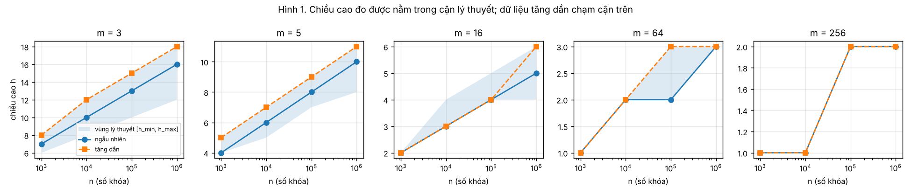
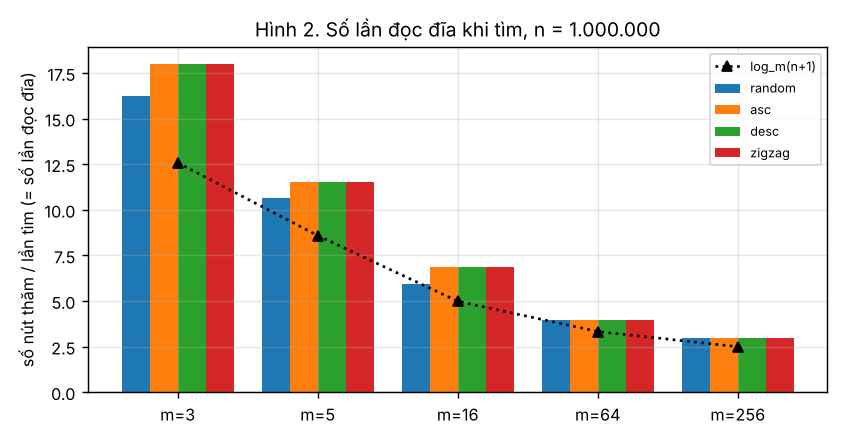
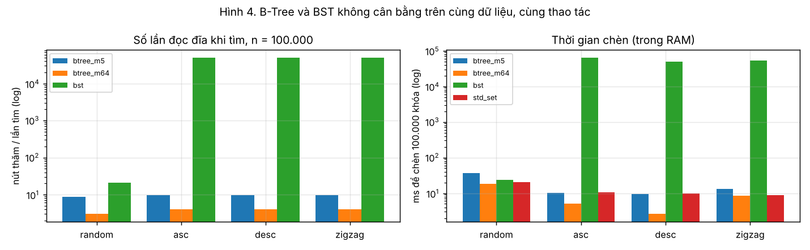
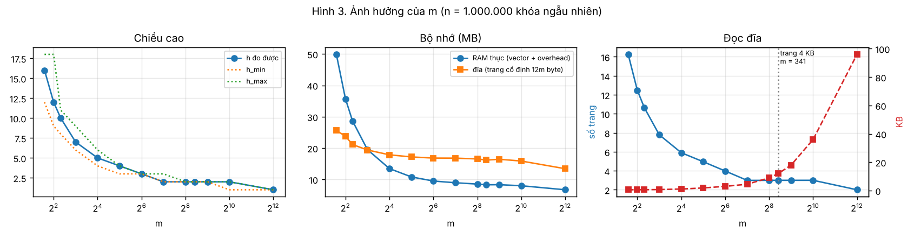
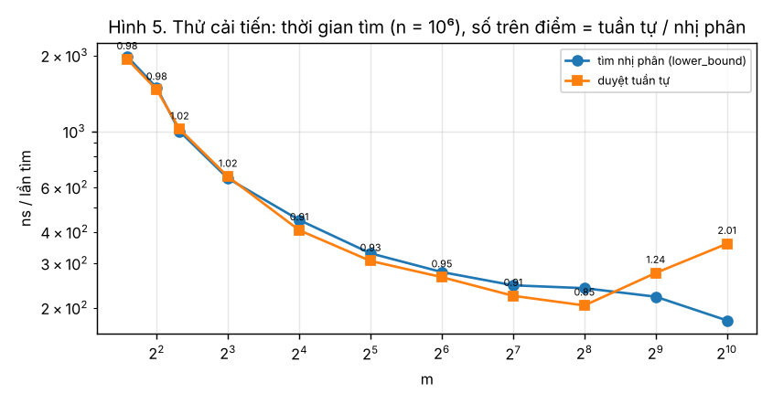

# Báo cáo Tuần 3 – Tính năng, thực nghiệm và phân tích

**Đề tài:** B-Tree for Disk-Oriented Search · **Sinh viên:** Đinh Mai Tuyết Nhi – 25110049 · **Ngôn ngữ:** C++17

## 1. Tóm tắt

| Yêu cầu Tuần 3 | Kết quả | Mục / file |
|---|---|---|
| Đủ tính năng | search, insert, remove, traverse, validate, height, đếm nút thăm; **mới:** đếm tách/gộp/mượn, `stats()` (số nút, độ lấp đầy, bộ nhớ), chọn cách tìm trong nút; BST không cân bằng để so sánh | Mục 2 · [src/](../../src) |
| Bộ thực nghiệm (harness) | `bench/bench.cpp`: 4 thực nghiệm, ghi CSV vào `results/`; `bench/plot.py` vẽ hình | Mục 3 |
| **GVHD (1):** chèn ≥ 100.000 khóa, chiều cao + số lần đọc đĩa, ≥ 3 giá trị m | n = 10<sup>5</sup> và 10<sup>6</sup>, **m = 3, 5, 16, 64, 256**, 4 kiểu dữ liệu | Mục 4 |
| Thực nghiệm vs lý thuyết | 80/80 cấu hình có h trong [h<sub>min</sub>, h<sub>max</sub>]; tìm không thấy luôn đọc đúng h + 1 nút; số lần tách khớp công thức tới 3 chữ số | Mục 5 |
| **GVHD (2):** so sánh BST cùng dữ liệu, cùng thao tác | BST suy biến (h = 99.999) khi dữ liệu có thứ tự; chèn chậm hơn B-Tree **4.000–6.000 lần** | Mục 6 |
| **GVHD (3):** ảnh hưởng của m lên chiều cao, bộ nhớ, đọc đĩa | Quét m = 3 … 4096 | Mục 7 |
| Kết quả trên dữ liệu đa dạng và đối kháng | ngẫu nhiên / tăng / giảm / zigzag; chèn-xóa ở ngưỡng tách-gộp | Mục 4, 6, 9 |
| Giải thích điều bất ngờ | 5 điều | Mục 8 |
| Thử một cải tiến | Duyệt tuần tự thay tìm nhị phân trong nút → **loại bỏ**, có số liệu | Mục 10 |
| Danh sách trường hợp biên | E1–E14, **14/14 PASS**; T1–T16 vẫn 45/45; stress 630.000 thao tác vẫn đạt | Mục 9 |

## 2. Tính năng

| Thành phần | Mô tả | Mới ở Tuần 3 |
|---|---|:---:|
| `search`, `insert`, `remove`, `traverse`, `validate`, `height`, `levels` | Như Tuần 2 | |
| `nodesVisited()` | Số nút được thăm = số lần đọc đĩa (mỗi nút là một trang) | |
| `splits()`, `merges()`, `borrows()`, `resetCounters()` | Đếm số lần tách / gộp / mượn. Mỗi lần tách hay gộp tương ứng một lần **ghi** thêm trang ra đĩa | ✓ |
| `stats()` | Số nút, số lá, số khóa, độ lấp đầy, bộ nhớ RAM thực (gồm `sizeof(Node)` và dung lượng 2 vector) và bộ nhớ nếu lưu đĩa với trang cố định 4 + 4(m − 1) + 8m byte | ✓ |
| `setNodeSearch(Binary / Linear)` | Chọn cách tìm vị trí trong một nút (phục vụ thử cải tiến, Mục 10) | ✓ |
| [`src/bst.h`](../../src/bst.h), [`src/bst.cpp`](../../src/bst.cpp) | BST **không cân bằng**, viết bằng vòng lặp (không đệ quy) để không tràn stack khi cây suy biến; xóa nút 2 con bằng khóa liền trước (giống quy ước B-Tree); cùng cách đếm nút thăm | ✓ |

## 3. Bộ thực nghiệm

```bash
g++ -std=c++17 -O2 -DNDEBUG -Isrc -o bench_btree bench/bench.cpp src/btree.cpp src/bst.cpp
./bench_btree all          # hoặc: height | bst | opt | msweep ; thêm --quick để chạy nhanh
python3 bench/plot.py      # vẽ 5 hình vào docs/week3/images/
g++ -std=c++17 -O2 -Isrc -o edge_cases tests/edge_cases.cpp src/btree.cpp src/bst.cpp && ./edge_cases
```

| Thực nghiệm | Nội dung | File kết quả |
|---|---|---|
| A – `height` | n = 10<sup>3</sup> … 10<sup>6</sup>; m = 3, 5, 16, 64, 256; 4 kiểu dữ liệu. Chèn n khóa → tìm 100.000 khóa có và 100.000 khóa không có → xóa n/2 khóa. Đo h, số nút, độ lấp đầy, bộ nhớ, số lần đọc đĩa mỗi thao tác, số tách/gộp/mượn, thời gian; `validate()` ở cuối | [results/height_reads.csv](../../results/height_reads.csv) |
| B – `bst` | B-Tree (m = 5, 64), BST, `std::set` trên **cùng** dãy khóa và **cùng** dãy thao tác: chèn n, tìm 10.000 có, tìm 10.000 không có, xóa ~10.000 | [results/btree_vs_bst.csv](../../results/btree_vs_bst.csv) |
| C – `opt` | Tìm nhị phân vs duyệt tuần tự trong nút, m = 3 … 1024, n = 10<sup>6</sup> | [results/opt_linear_vs_binary.csv](../../results/opt_linear_vs_binary.csv) |
| D – `msweep` | Quét m = 3 … 4096, n = 10<sup>6</sup> ngẫu nhiên: h, bộ nhớ, số trang và số byte đọc mỗi lần tìm | [results/m_sweep.csv](../../results/m_sweep.csv) |

**Dữ liệu.** Khóa là các số chẵn 0, 2, …, 2(n − 1), nên mọi số lẻ chắc chắn không có trong cây (dùng cho tìm không thành công). Bốn kiểu thứ tự chèn: *random* (hoán vị ngẫu nhiên, seed cố định), *asc* (tăng dần), *desc* (giảm dần), *zigzag* (0, max, 2, max − 2, … – nhỏ và lớn xen kẽ, đối kháng với BST).

**Cách đo.** Thực nghiệm A lặp 5 lần với 5 seed, lấy **trung vị** cho số lần đọc và thời gian; C lặp 7 lần. Số lần đọc đĩa là số đếm chính xác, không phụ thuộc máy. Thời gian đo bằng `std::chrono::steady_clock` trên máy ảo 1 nhân (Intel Xeon 2,1 GHz, g++ 13.3, `-O2`), nên dao động khoảng ±20 % giữa các lần chạy; chỉ nên so sánh thời gian *trong cùng một bảng*.

**Mô hình đĩa.** Mỗi nút là một trang; thăm một nút = đọc một trang. Đây là mô hình của đề bài (Lesson 8 & 9). Nó bỏ qua bộ đệm (thực tế gốc và tầng 1 thường nằm sẵn trong RAM), nên số đo là cận trên của số lần đọc thật.

## 4. Yêu cầu GVHD (1): chèn ≥ 100.000 khóa – chiều cao và số lần đọc đĩa

h<sub>min</sub> = ⌈log<sub>m</sub>(n + 1)⌉ − 1, h<sub>max</sub> = ⌊log<sub>t</sub>((n + 1)/2)⌋ với t = ⌈m/2⌉ (Tuần 1, Mục 3.3). “Đọc/tìm có” là số nút thăm trung bình khi khóa có trong cây; “đọc/tìm không có” khi khóa không có.

**n = 100.000**

| m | Kiểu | h đo | [h<sub>min</sub>, h<sub>max</sub>] | Số nút | Đọc/chèn | Đọc/tìm có | Đọc/tìm không có | Đọc/xóa |
|:---:|---|:---:|:---:|---:|---:|---:|---:|---:|
| 3 | random | 12–13 | [10, 15] | 74.635 | 12,57 | 13,25 | 14 | 13,51 |
| 3 | asc | **15** | [10, 15] | 99.994 | 14,69 | 15,00 | 16 | 15,01 |
| 5 | random | 8 | [7, 9] | 36.908 | 8,29 | 8,63 | 9 | 9,00 |
| 5 | asc | **9** | [7, 9] | 49.995 | 9,41 | 9,50 | 10 | 10,00 |
| 16 | random | 4 | [4, 5] | 9.772 | 4,73 | 4,90 | 5 | 5,00 |
| 16 | desc | **5** | [4, 5] | 14.284 | 5,20 | 5,86 | 6 | 5,19 |
| 64 | random | 2 | [2, 3] | 2.296 | 2,97 | 2,98 | 3 | 3,00 |
| 64 | asc | **3** | [2, 3] | 3.124 | 3,27 | 3,97 | 4 | 3,41 |
| 256 | random | 2 | [2, 2] | 543 | 2,53 | 3,00 | 3 | 3,00 |
| 256 | asc | 2 | [2, 2] | 782 | 2,67 | 2,99 | 3 | 3,00 |

**n = 1.000.000**

| m | Kiểu | h đo | [h<sub>min</sub>, h<sub>max</sub>] | Số nút | Đọc/chèn | Đọc/tìm có | Đọc/tìm không có | Đọc/xóa |
|:---:|---|:---:|:---:|---:|---:|---:|---:|---:|
| 3 | random | 15–16 | [12, 18] | 745.853 | 15,29 | 16,25 | 17 | 16,05 |
| 3 | asc | **18** | [12, 18] | 999.993 | 17,95 | 18,01 | 19 | 18,05 |
| 5 | random | 10 | [8, 11] | 369.197 | 10,08 | 10,63 | 11 | 11,00 |
| 5 | asc | **11** | [8, 11] | 499.993 | 11,47 | 11,50 | 12 | 12,00 |
| 16 | random | 5 | [4, 6] | 97.246 | 5,70 | 5,90 | 6 | 6,00 |
| 16 | asc | **6** | [4, 6] | 124.999 | 5,88 | 6,88 | 7 | 6,11 |
| 64 | random | 3 | [3, 3] | 22.950 | 3,85 | 3,98 | 4 | 4,00 |
| 64 | asc | 3 | [3, 3] | 31.249 | 3,93 | 3,97 | 4 | 4,00 |
| 256 | random | 2 | [2, 2] | 5.642 | 2,95 | 3,00 | 3 | 3,00 |
| 256 | asc | 2 | [2, 2] | 7.812 | 2,97 | 2,99 | 3 | 3,00 |

Đủ 80 dòng (thêm desc, zigzag, n = 10<sup>3</sup>, 10<sup>4</sup>, thời gian, số gộp/mượn) nằm trong CSV. Mọi cây đều `validate()` đúng sau khi xóa một nửa số khóa.





**Đọc bảng:** với một triệu khóa, B-Tree bậc 256 chỉ cần **3 lần đọc đĩa** cho mỗi lần tìm; bậc 3 cần 16–19 lần. Dữ liệu có thứ tự (asc/desc/zigzag) làm cây **chạm đúng cận trên h<sub>max</sub>** ở m = 3, 5, 16 (các ô in đậm).

## 5. So sánh thực nghiệm với lý thuyết

| Dự đoán lý thuyết | Thực nghiệm | Khớp? |
|---|---|:---:|
| h<sub>min</sub> ≤ h ≤ h<sub>max</sub> (Tuần 1, Mục 3.3) | 80/80 cấu hình (× 5 seed) nằm trong khoảng | ✓ |
| Tìm không thành công luôn đi tới lá: đúng **h + 1** nút | Cột “đọc/tìm không có” bằng đúng h + 1 ở mọi dòng (ở hai dòng random m = 3, h đổi theo seed: 12–13 và 15–16; trung vị 14 và 17 ứng với h lớn) | ✓ |
| Tìm thành công ≤ h + 1 nút; nhỏ hơn một chút vì một số khóa nằm ở nút trong | Ví dụ n = 10<sup>6</sup>, m = 5: 10,63 < 11. Số nút thăm **lớn nhất** đo trên 2.000 lần tìm = h + 1 | ✓ |
| Mỗi nút (trừ nút đầu tiên) sinh ra từ đúng một lần tách, nên số tách / số chèn ≈ số nút / n = 1 / (f · (m − 1)), f là độ lấp đầy | n = 10<sup>6</sup>, m = 5 random: đo **0,3692**, công thức cho 1 / (0,677 · 4) = **0,3693**. Mọi dòng khớp tới 3 chữ số | ✓ |
| Chèn ngẫu nhiên: độ lấp đầy tiến tới ln 2 ≈ 69 % (kết quả “fringe analysis” của Yao, 1978) | f = 0,670 (m = 3) … 0,695 (m = 256) | ✓ |
| Chèn có thứ tự: mỗi lần tách bỏ lại một nút ở mức tối thiểu ⌈m/2⌉ − 1 khóa, nên f ≈ 50 % và h chạm h<sub>max</sub> | f = 0,500 với m lẻ, h = h<sub>max</sub> ở m = 3, 5, 16 | ✓ (m chẵn: xem Mục 8.2) |
| Search O(log n) số nút thăm | Từ n = 10<sup>3</sup> lên 10<sup>6</sup> (× 1000), số nút thăm với m = 5 tăng **cộng thêm** 6,0 (4,6 → 10,6), không nhân lên. Với số con trung bình mỗi nút ≈ 1 + f(m − 1) ≈ 3,7, dự đoán cộng thêm log<sub>3,7</sub> 1000 ≈ 5,3 (lệch một phần vì cây nhỏ chưa đạt độ lấp đầy ổn định) | ✓ |
| BST ngẫu nhiên: độ sâu trung bình ≈ 2·H<sub>n</sub> − 4 (H<sub>n</sub> là số điều hòa) nên tìm có thăm ≈ 2·H<sub>n</sub> − 3 nút | n = 10<sup>5</sup>: dự đoán 21,2, đo **21,06**; n = 10<sup>6</sup>: dự đoán 25,8, đo **25,54** | ✓ |
| BST với dữ liệu có thứ tự: h = n − 1, tìm có thăm trung bình n/2 nút | h = **99.999**, tìm có thăm **49.442** nút | ✓ |
| Thời gian CPU của search O(log n) | **Không khớp hoàn toàn**: từ 10<sup>3</sup> lên 10<sup>6</sup>, số nút thăm tăng 2,3 lần nhưng thời gian (m = 5) tăng **12 lần** (70 → 865 ns). Giải thích ở Mục 8.3 | ✗ |

## 6. Yêu cầu GVHD (2): B-Tree so với BST trên cùng dữ liệu, cùng thao tác

Cùng dãy khóa, cùng 10.000 khóa tìm có, 10.000 khóa tìm không có và cùng dãy khóa xóa cho cả bốn cấu trúc. Thời gian là tổng của cả dãy thao tác (ms). `std::set` (cây đỏ-đen) chỉ làm mốc thời gian, không đếm được nút thăm; bộ nhớ của nó là ước lượng 40 byte/nút. Cột “đúng” là kết quả `traverse()` sau khi xóa so với `std::set`.

| n | Kiểu | Cấu trúc | h sau khi chèn | RAM (MB) | Chèn (ms) | Đọc/tìm có | Đọc/tìm không có | Tìm (ms) | Xóa (ms) | Đúng |
|---:|---|---|---:|---:|---:|---:|---:|---:|---:|:---:|
| 10<sup>5</sup> | random | B-Tree m = 5 | 8 | 2,85 | 36,6 | 8,63 | 9 | 3,6 | 4,4 | ✓ |
| | | B-Tree m = 64 | 2 | 0,95 | 18,6 | 2,98 | 3 | 1,3 | 1,4 | ✓ |
| | | BST | 39 | 2,29 | 24,0 | 21,06 | 22,0 | 2,3 | 2,5 | ✓ |
| | | std::set | – | ~3,8 | 20,5 | – | – | 2,7 | 2,8 | ✓ |
| 10<sup>5</sup> | asc | B-Tree m = 5 | 9 | 4,58 | 10,1 | 9,50 | 10 | 3,6 | 4,5 | ✓ |
| | | B-Tree m = 64 | 3 | 1,71 | 5,1 | 3,97 | 4 | 1,2 | 1,4 | ✓ |
| | | **BST** | **99.999** | 2,29 | **63.065** | **49.442** | **50.161** | **5.759** | **6.356** | ✓ |
| | | std::set | – | ~3,8 | 10,4 | – | – | 3,8 | 3,4 | ✓ |
| 10<sup>5</sup> | desc | B-Tree m = 5 | 9 | 3,05 | 9,4 | 9,50 | 10 | 4,0 | 5,6 | ✓ |
| | | BST | 99.999 | 2,29 | 48.421 | 49.442 | 50.160 | 4.427 | 4.311 | ✓ |
| 10<sup>5</sup> | zigzag | B-Tree m = 5 | 9 | 3,81 | 13,1 | 9,49 | 10 | 3,9 | 5,7 | ✓ |
| | | BST | 99.999 | 2,29 | 52.589 | 49.442 | 50.162 | 4.927 | 4.329 | ✓ |
| 10<sup>6</sup> | random | B-Tree m = 5 | 10 | 28,66 | 888 | 10,62 | 11 | 7,0 | 8,3 | ✓ |
| | | B-Tree m = 64 | 3 | 9,46 | 307 | 3,98 | 4 | 2,5 | 2,5 | ✓ |
| | | BST | 48 | 22,89 | 910 | 25,54 | 26,6 | 11,6 | 10,3 | ✓ |
| | | std::set | – | ~38 | 643 | – | – | 9,8 | 9,2 | ✓ |

(Bảng đủ có cả B-Tree m = 64 và std::set cho desc/zigzag.) BST với 10<sup>6</sup> khóa có thứ tự không chạy: cần khoảng n²/2 = 5·10<sup>11</sup> bước, ước tính hơn 1 giờ.



**Nhận xét.**
1. **Dữ liệu có thứ tự (asc/desc/zigzag):** BST suy biến thành danh sách liên kết. Chèn 100.000 khóa mất 48–63 giây so với 9–13 ms của B-Tree m = 5, tức chậm hơn **4.000–6.000 lần**. Mỗi lần tìm phải đọc ~49.000 nút thay vì 10. B-Tree không bị ảnh hưởng vì luôn cân bằng (mọi lá cùng tầng).
2. **Dữ liệu ngẫu nhiên:** BST không suy biến (h = 39 và 48) nhưng vẫn đọc nhiều nút gấp **2,4 lần** B-Tree m = 5 và **6,4 lần** B-Tree m = 64. Nếu mỗi lần đọc là một lần truy cập ngẫu nhiên vào đĩa cứng (giả định ~10 ms), một lần tìm trên 10<sup>6</sup> khóa tốn khoảng 255 ms với BST, 106 ms với B-Tree m = 5 và 40 ms với m = 64.
3. **Trong RAM, BST ngẫu nhiên không thua về thời gian** (24 ms so với 36,6 ms khi chèn). Đây là điều đáng chú ý, giải thích ở Mục 8.4.
4. **Bộ nhớ:** BST 24 byte/khóa (4 byte khóa + 4 byte căn lề + 2 con trỏ 8 byte; cả hai cấu trúc đều chưa tính chi phí của bộ cấp phát). B-Tree m = 5 tốn nhiều hơn (mỗi nút có 2 vector, mỗi vector có phần thừa); B-Tree m = 64 tốn ít hơn BST 2,4 lần vì chi phí cố định mỗi nút được chia cho nhiều khóa.

## 7. Yêu cầu GVHD (3): ảnh hưởng của m lên chiều cao, bộ nhớ và số lần đọc đĩa

n = 10<sup>6</sup> khóa ngẫu nhiên. “Trang” là kích thước một nút trên đĩa: 4 byte đếm khóa + 4(m − 1) byte khóa + 8m byte con trỏ = 12m byte.

| m | h | Số nút | f | RAM (MB) | Đĩa (MB) | Trang (byte) | Trang đọc / lần tìm | KB đọc / lần tìm | ns / lần tìm |
|---:|---:|---:|---:|---:|---:|---:|---:|---:|---:|
| 3 | 16 | 746.291 | 0,67 | 49,9 | 25,6 | 36 | 16,26 | 0,6 | 1516 |
| 5 | 10 | 369.071 | 0,68 | 28,6 | 21,1 | 60 | 10,63 | 0,6 | 1152 |
| 16 | 5 | 97.414 | 0,68 | 13,5 | 17,8 | 192 | 5,90 | 1,1 | 433 |
| 64 | 3 | 22.936 | 0,69 | 9,5 | 16,8 | 768 | 3,98 | 3,0 | 272 |
| 128 | 2 | 11.452 | 0,69 | 8,9 | 16,8 | 1.536 | 2,99 | 4,5 | 247 |
| 256 | 2 | 5.641 | 0,70 | 8,5 | 16,5 | 3.072 | 2,99 | 9,0 | 232 |
| **341** | 2 | 4.141 | 0,71 | 8,3 | 16,2 | **4.092** | **3,00** | 12,0 | 228 |
| 1024 | 2 | 1.353 | 0,72 | 8,0 | 15,9 | 12.288 | 3,00 | 36,0 | 190 |
| 4096 | 1 | 286 | 0,85 | 6,7 | 13,4 | 49.152 | 2,00 | 96,0 | 209 |



**Chiều cao.** h ≈ log<sub>m</sub> n: bình phương m (4 → 16, 16 → 256) thì h giảm khoảng một nửa (12 → 5, 5 → 2). Nhưng giảm dần chậm lại: từ m = 128 tới m = 1024, h vẫn là 2.

**Bộ nhớ.** Tổng bộ nhớ là O(n) với mọi m (Tuần 2, Mục 4), nên chỉ đổi theo hằng số:
- *Trên đĩa (trang cố định):* ≈ 12n / f byte, gần như không đổi (16–26 MB). m nhỏ tốn hơn vì tỉ lệ con trỏ trên khóa cao hơn: mỗi nút m − 1 khóa nhưng m con trỏ, m = 3 là 3 con trỏ cho 2 khóa.
- *Trong RAM:* m nhỏ tốn **gấp 6 lần** m lớn (49,9 so với 8,3 MB) vì mỗi nút có chi phí cố định (`sizeof(Node)` = 48 byte cho 2 vector) và phần dung lượng thừa của vector. Số này còn chưa tính chi phí của bộ cấp phát (mỗi nút có 2 vùng nhớ riêng), nên chênh lệch thật còn lớn hơn. Có 746.000 nút ở m = 3 nhưng chỉ 4.000 nút ở m = 341.
- *Độ lấp đầy* ~69 % với dữ liệu ngẫu nhiên, nghĩa là ~31 % chỗ trong trang bị bỏ trống. Với dữ liệu có thứ tự còn tệ hơn: 50 % (Mục 4).

**Số lần đọc đĩa.** Có hai đại lượng ngược chiều nhau:
- *Số trang đọc* giảm theo m (16 → 3);
- *Số byte đọc* lại **tăng** theo m (0,6 KB → 96 KB), vì h ≈ log<sub>m</sub> n giảm chậm hơn kích thước trang 12m tăng.

Với đĩa thật, chi phí chính là **số lần truy cập** (thời gian tìm vị trí trên đĩa cứng, hoặc độ trễ mỗi yêu cầu trên SSD); đọc 36 byte hay 4 KB trong cùng một khối tốn gần như bằng nhau, vì đĩa luôn đọc nguyên khối. Vậy nên chọn m **lớn nhất mà một nút vẫn vừa một khối đĩa**: với khối 4 KB, 12m ≤ 4096 ⇒ **m = 341**, cho 3 lần đọc với 10<sup>6</sup> khóa. Tăng m quá một khối (1024, 4096) bắt đầu phải đọc nhiều khối cho mỗi nút, số byte đọc tăng mạnh trong khi số tầng giảm rất ít.

**Thời gian CPU.** Trong RAM, m lớn cũng nhanh hơn (1516 → 228 ns) vì ít lần nhảy con trỏ sang vùng nhớ khác hơn, mỗi lần nhảy dễ gây trượt cache (Mục 8.3). Đổi lại, chèn/xóa ở nút lớn phải dịch O(m) phần tử.

**Kết luận về m.** m nhỏ: cây cao, nhiều nút, tốn bộ nhớ cho con trỏ và chi phí nút, nhiều lần đọc đĩa. m lớn: cây thấp, ít lần đọc, nhưng mỗi nút tốn công dịch phần tử khi chèn/xóa và nếu vượt quá một khối đĩa thì lãng phí băng thông. Chọn **m sao cho một nút vừa một khối đĩa** (m ≈ 341 với khối 4 KB, khóa `int`, con trỏ 8 byte). m = 5 của đề tài là để chạy tay và kiểm thử, không phải giá trị dùng thật.

## 8. Những điều bất ngờ và giải thích

**8.1. Dữ liệu tăng dần làm cây cao hơn nhưng chèn lại nhanh hơn (tới 6–8 lần khi n = 10<sup>6</sup>).** Ví dụ n = 10<sup>6</sup>, m = 5: asc chèn 135 ns/khóa, random 807 ns/khóa, dù cây asc cao hơn (11 so với 10). Chênh lệch tăng theo n (1,3–4,5 lần ở n = 10<sup>3</sup>, 6–8 lần ở n = 10<sup>6</sup>), đúng như dự đoán nếu nguyên nhân là cache. Lý do: khóa tăng dần luôn đi theo cùng một đường bên phải, nên các nút trên đường đó luôn nằm sẵn trong cache CPU; khóa ngẫu nhiên mỗi lần đi một đường khác, gần như mọi nút đều trượt cache. Nếu là đĩa thật, điều tương tự xảy ra với bộ đệm trang của hệ điều hành. Vì vậy cơ sở dữ liệu thường chèn khóa tăng dần (ví dụ khóa tự tăng).

**8.2. m chẵn: dữ liệu tăng và giảm cho cây khác nhau.** Với m = 16, n = 10<sup>5</sup>: asc cho h = 4, f = 0,533; desc cho h = 5, f = 0,467. Với m lẻ hai kiểu cho kết quả giống hệt. Lý do nằm ở quy tắc tách (Tuần 1, Mục 3.6): nút tràn có m = 16 khóa, giữ **m/2 = 8** khóa bên trái, đẩy khóa thứ 9 lên, còn **7** khóa bên phải. Khi chèn tăng dần, nút bên trái (8 khóa) bị bỏ lại, nên f = 8/15 = 0,533. Khi chèn giảm dần, khóa mới luôn vào bên trái, nên nút bên phải (7 khóa, đúng mức tối thiểu) bị bỏ lại, f = 7/15 = 0,467 và cây cao thêm một tầng. Với m lẻ, hai nửa bằng nhau ((m − 1)/2 khóa) nên không lệch. Điều này không có trong lý thuyết chung về B-Tree vì phụ thuộc quy ước tách của cài đặt.

**8.3. Thời gian tìm tăng nhanh hơn log n.** Số nút thăm tăng 2,3 lần khi n tăng 1000 lần (đúng log), nhưng thời gian tăng 12 lần. Mô hình RAM của phân tích độ phức tạp coi mọi truy cập bộ nhớ có giá như nhau. Thực tế: với 10<sup>3</sup> khóa, cả cây (~30 KB) nằm trong cache L1/L2; với 10<sup>6</sup> khóa (~29 MB) cây lớn hơn cache, nên mỗi nút ở tầng dưới là một lần trượt cache (~100 ns). Bộ nhớ chính đóng vai trò “đĩa” đối với cache. Đây chính là lý do B-Tree cũng được dùng làm cấu trúc trong RAM: **m lớn giảm số lần trượt cache** giống như giảm số lần đọc đĩa (Mục 7).

**8.4. Trong RAM, BST ngẫu nhiên nhanh ngang (hoặc hơn) B-Tree m = 5 dù thăm nhiều nút gấp 2,4 lần.** Lý do: một nút BST rất nhỏ và so sánh ở mỗi nút chỉ một phép, trong khi mỗi nút B-Tree m = 5 cần `lower_bound` trên một `vector` riêng (thêm một lần nhảy con trỏ tới vùng nhớ của vector) và chèn phải dịch phần tử. Lợi thế của B-Tree chỉ hiện ra khi **chi phí mỗi lần thăm nút lớn** (đọc đĩa), hoặc khi m đủ lớn (m = 64 tìm nhanh hơn BST 1,8 lần ở n = 10<sup>5</sup> và 4,7 lần ở n = 10<sup>6</sup>). Đây đúng là lý do đề tài gọi là “disk-oriented”.

**8.5. Không có “vùng đệm” giữa tách và gộp.** Trường hợp E10 (Mục 9): ở một cây 2.047 khóa với m = 3, chèn rồi xóa cùng một khóa lặp lại 10.000 lần gây **6 lần tách cho mỗi lần chèn và 6 lần gộp cho mỗi lần xóa**, thay vì 0 hay 1. E9 cho kết quả tương tự ở cây nhỏ: 100.000 tách và 100.000 gộp. Nguyên nhân: quy ước của chúng em gộp ngay khi nút xuống dưới mức tối thiểu và tách ngay khi tràn, nên một nút ở đúng ngưỡng bị tách rồi gộp lại liên tục. Với dữ liệu ngẫu nhiên điều này hiếm (số gộp/lần xóa trung bình ~0,7 ở m = 3 và ~0,005 ở m = 256), nhưng một dãy thao tác đối kháng có thể làm mỗi thao tác tốn h lần ghi đĩa. Cách khắc phục (chưa cài đặt, để ngoài phạm vi): chỉ gộp khi nút trống hẳn hoặc dưới một ngưỡng thấp hơn (“lazy deletion”), hoặc chia khóa sang anh em trước khi tách (B\*-Tree).

## 9. Danh sách trường hợp biên và kết quả

Chạy: `./edge_cases` ([tests/edge_cases.cpp](../../tests/edge_cases.cpp)). Toàn bộ cũng đã chạy với AddressSanitizer và UndefinedBehaviorSanitizer, không có lỗi.

| Mã | Trường hợp | Mong đợi | Thực tế | KQ |
|---|---|---|---|:---:|
| E1 | Cây rỗng: search, remove, height, traverse, validate | false, false, −1, rỗng, true | đúng như mong đợi | PASS |
| E2 | Chèn 1 khóa rồi xóa nó | cây rỗng lại, h = −1 | h = −1, search = false | PASS |
| E3 | Chèn cùng một khóa 100.000 lần | `true` đúng 1 lần, kích thước 1 | `true` 1 lần, kích thước 1 | PASS |
| E4 | Khóa INT_MIN, INT_MAX, 0, −1, 1, … (m = 3) | tìm thấy hết, thứ tự đúng, hợp lệ | đúng (validate dùng `long long` cho biên nên không tràn số) | PASS |
| E5 | m = 2, 1, 0, −5 | ném `invalid_argument` 4/4 | 4/4 | PASS |
| E6 | m = 3, 4, 6; chèn 5.000 khóa tăng rồi giảm, `validate` sau **mỗi** lần chèn | luôn hợp lệ | luôn hợp lệ | PASS |
| E7 | Xóa hết 20.000 khóa theo thứ tự tăng / giảm / ngẫu nhiên, rồi chèn lại 100 khóa | cây rỗng, h = −1, chèn lại đúng | đúng cả 3 thứ tự | PASS |
| E8 | Xóa −1 (nhỏ hơn min), 5000 (lớn hơn max), 501 (nằm giữa) trên cây 1.000 khóa chẵn | `false`, cây không đổi | `false`, cây không đổi | PASS |
| E9 | **Đối kháng:** lặp 100.000 lần {chèn 5; xóa 5} trên cây [1 2 3 4], m = 5 | 100.000 tách, 100.000 gộp, h = 0 | 100.000 tách, 100.000 gộp, h = 0 | PASS |
| E10 | **Đối kháng:** m = 3, 2.047 khóa chẵn ngẫu nhiên; thử mọi khóa lẻ, lấy khóa gây tách nhiều nhất rồi lặp {chèn; xóa} 10.000 lần | tách dây chuyền nhiều tầng, cây vẫn hợp lệ | khóa 773: 6 tách/lần chèn, 6 gộp/lần xóa, h giữ 8 (lần thử đầu 7 tách) | PASS |
| E11 | Chế độ Linear vs Binary, 100.000 thao tác trộn, m = 3, 5, 16, 64 | cùng cây, cùng số nút thăm | giống hệt | PASS |
| E12 | m = 100.001, chèn 100.000 khóa | h = 0, tìm thăm 1 nút | h = 0, 1 nút | PASS |
| E13 | BST: 200.000 chèn/xóa ngẫu nhiên, đối chiếu `std::set` | khớp | khớp | PASS |
| E14 | BST chèn 0 … 19.999 tăng dần | h = 19.999, tìm 19.999 thăm 20.000 nút, không tràn stack | đúng | PASS |

**Kết quả: 14/14 PASS.** Unit test T1–T16 vẫn **45/45**, kiểm tra áp lực 630.000 thao tác vẫn đạt sau khi thêm bộ đếm và `stats()` (code cũ không bị ảnh hưởng). Ngoài ra, ở thực nghiệm A, 80/80 cây (mỗi cây 5 lần) đều `validate()` đúng sau khi xóa một nửa số khóa; ở thực nghiệm B, kết quả `traverse()` của mọi cấu trúc đều khớp `std::set`.

## 10. Thử cải tiến: duyệt tuần tự thay cho tìm nhị phân trong nút

**Giả thuyết (kế hoạch Tuần 1).** Trong mỗi nút, duyệt tuần tự (`while (keys[i] < key) ++i`) đơn giản hơn tìm nhị phân, và dữ liệu liền nhau trong bộ nhớ nên CPU đọc trước được. Có thể nhanh hơn với m nhỏ, chậm hơn với m lớn. Số nút thăm (số lần đọc đĩa) **không đổi** vì chỉ thay cách tìm *bên trong* một nút; E11 kiểm chứng điều này (cùng cây, cùng số nút thăm).

**Kết quả** (n = 10<sup>6</sup> ngẫu nhiên, 10<sup>6</sup> lần tìm, trung vị 7 lần chạy):

| m | 3 | 4 | 5 | 8 | 16 | 32 | 64 | 128 | 256 | 512 | 1024 |
|---|---:|---:|---:|---:|---:|---:|---:|---:|---:|---:|---:|
| Nhị phân (ns) | 1983 | 1490 | 1000 | 651 | 445 | 329 | 277 | 246 | 239 | 221 | 178 |
| Tuần tự (ns) | 1934 | 1463 | 1020 | 662 | 406 | 307 | 265 | 223 | 204 | 275 | 359 |
| Tuần tự / nhị phân | 0,98 | 0,98 | 1,02 | 1,02 | 0,91 | 0,93 | 0,95 | 0,91 | 0,85 | **1,24** | **2,01** |



**Quyết định: LOẠI BỎ, giữ tìm nhị phân làm mặc định.** Lý do:
1. Với m ≤ 8 hai cách ngang nhau (chênh ≤ 2 %, nhỏ hơn độ dao động đo ±20 %).
2. Với 16 ≤ m ≤ 256 tuần tự nhanh hơn 5–15 %, nhưng chỉ vài chục nanô giây mỗi lần tìm, trong khi một lần đọc đĩa tốn cỡ 0,1 ms (SSD) tới 10 ms (HDD). Số lần đọc đĩa không đổi, nên trong mô hình đĩa của đề tài cải tiến này không có tác dụng.
3. Với m ≥ 512 tuần tự **chậm hơn rõ rệt** (1,24 và 2,01 lần), mà vùng m hợp lý cho đĩa (m ≈ 341, Mục 7) nằm ngay gần điểm giao nhau.
4. Một cách lai (tuần tự khi nút nhỏ, nhị phân khi nút lớn) có thể lấy được 5–15 %, nhưng thêm một ngưỡng phụ thuộc máy. Không đáng với lợi ích nhỏ như vậy.

Chế độ `Linear` vẫn để lại trong code (`setNodeSearch`) để chạy lại được thực nghiệm này.

## 11. Chỗ AI làm sai / thiếu trong Tuần 3 và cách phát hiện

| # | Sai / thiếu | Cách phát hiện | Cách sửa |
|:---:|---|---|---|
| 1 | Trường hợp đối kháng E10 bản đầu dùng cây m = 3 chèn **tăng dần**, mong đợi tách dây chuyền. Thực tế ra **0 lần tách**: chèn tăng dần với m = 3 cho mọi nút đúng 1 khóa (f = 0,5, Mục 5), nên không nút nào đầy. | E10 báo FAIL (“0 tách/lần chèn”), đối chiếu với độ lấp đầy 0,500 đo ở thực nghiệm A. | Dựng cây bằng thứ tự ngẫu nhiên, rồi **thử mọi khóa lẻ** để tìm khóa gây tách nhiều nhất thay vì đoán. |
| 2 | Thực nghiệm A ban đầu ghi chiều cao của *lần chạy cuối*, nhưng số lần đọc là *trung vị 5 lần chạy*. Với random m = 3, h đổi theo seed (12 hoặc 13), nên có dòng “đọc/tìm không có = 14” trong khi h = 12. | Viết đoạn kiểm tra tự động “đọc/tìm không có == h + 1” trên CSV: 1 dòng sai. | Thêm cột `h_obs_lo`, `h_obs_hi` (h nhỏ nhất / lớn nhất qua các lần chạy), rồi chạy lại. |
| 3 | So sánh BST bản đầu đo chiều cao **sau khi xóa** (90.460) thay vì ngay sau khi chèn (99.999), làm bảng so sánh không đúng với lý thuyết h = n − 1. | Đối chiếu với lý thuyết: dữ liệu tăng dần phải cho h = n − 1. | Đo h và bộ nhớ ngay sau khi chèn xong. |
| 4 | Gọi `std::system("mkdir -p results")`: bị cảnh báo bỏ qua giá trị trả về và phụ thuộc shell. | Biên dịch với `-Wall -Wextra -Werror`. | Dùng `std::filesystem::create_directories`. |

## 12. Kế hoạch Tuần 4

Hoàn thiện báo cáo tổng; README hướng dẫn chạy toàn bộ; ôn vấn đáp: tự giải thích lại được mọi bảng và hình ở báo cáo này, chạy tay lại các phép tách/gộp với m chẵn (Mục 8.2) và trường hợp E9.
